# Yazılım planlama süreci: tasarım

Durum: taslak, sürüm 6 (2026-11-10). Sürüm 5, istekte "v4" diye anılan sürümdü; dosyadaki sürüm 4 dış incelemenin sonucuydu. Sürüm 1 Fable ile, sürüm 2 şeytanın avukatı ile, sürüm 3 dış incelemeyle gözden geçirildi; sürüm 5 durum tutarlılığı, eşzamanlılık, hata yönetimi, güvenlik, maliyet ve izlenebilirlik için sağlamlaştırıldı, sonra aşırı mühendisliğe karşı sadeleştirildi. Sürüm 6 kullanıcının onayladığı hızlı yolu ekler: 12 aşama yerine 8 adım ve iki kullanıcı oturumu, ne nerede indeksi, tek seferde tam yazım ve daha dar bir faz 1 kapsamı. Kayıtlar bölüm 15'te, uygulama öncesi denetim bölüm 16'da.

## 1. Amaç

Kullanıcı projesini sabit bir formatta yazar. Planlama ekibi bu yazıdan mimari stratejiyi, tamamlanmış özellik listesini, tasarımı (veritabanı modeli, akışlar, altyapı), güvenlik ve performans mimarisini ve kalite planını çıkarır. Kullanıcı kapılarda karar verir. Sonuç, seçilen profilin geliştirme ekibine verilen görevlerdir; geliştirme ekibi bu görevleri kendi kurallarına göre planlar ve uygular.

Ölçülebilir hedefler:
- Kullanıcı en çok 4 temasta karar verir: ara soru 1, A oturumu (G1 ve G2), ara soru 2 ve B oturumu (G3) (7.1). Bu tavanı yalnız bir kapı düzeltme turu (kapı başına 1) ve bir sınırın dolması (`blocked`, 7.12) aşabilir; `status` her teması sayar.
- Bir çalıştırma tipik olarak 14–18 rol çağrısıyla biter; tavan 24 çağrıdır (7.9, 12.1).
- Her rol çağrısı bütün belgeleri değil, okuma listesindeki kimlik bloklarını ve ne nerede indeksini alır (7.14).
- Kabul edilen her özellik tasarım izlenebilirliğini (F, US, EARS veya BR, D veya gerekçeli `none`, dilim, planlanan doğrulama) G3'ten önce, devir izlenebilirliğini (ek olarak görev) devirden sonra %100 sağlar (10.4).
- Süreç herhangi bir komutun ortasında kesilirse bir sonraki komut durumu günlükten kurtarır ve kaldığı yerden sürer (7.3).
- Aynı komutun tekrarı durumu ikinci kez değiştirmez (7.3).
- Başarısız zorunlu kontrol hiçbir yolla başarılı gösterilmez (7.8).
- Her döngünün ve bütçenin tavanı vardır; yaklaşınca uyarır, dolunca durur ve sorar (7.9, 7.12).
- Plan dosya yapısı içermez (2, ilke 13).
- Hiçbir hedef onay uygulamasına veya archify'a bağlı değildir.

## 2. Tasarım ilkeleri

1. Tek merkez ana oturumdaki Lead'dir. Alt ajan başka alt ajan başlatamaz ve kullanıcıya soru soramaz.
2. Sırayı model değil script tutar: `plan_state.py` adımları, kapıları, sayaçları ve tur kurallarını uygular. Model içeriği üretir.
3. Dosyalar API'dir: Lead, roller ve onay uygulaması yalnız proje dosyalarıyla konuşur.
4. Tek yazar: durum dosyalarını yalnız `plan_state.py` yazar; her ürün belgesinin tek sahip rolü vardır.
5. Önce günlük: her değişiklik önce yalnız eklenen günlüğe yazılır, durum dosyası günlükten türetilir.
6. Her komut idempotenttir: işlem anahtarı, deneme kimliği ve devir kimliği tekrarları etkisiz kılar.
7. Sessiz geçiş yoktur: bilinmeyen değer `unknown`, belirsiz değişiklik güvenli tarafa (etkili) sayılır, başarısız zorunlu kontrol risk kabulüyle geçmez.
8. Kimlikler değişmez ve yeniden kullanılmaz.
9. Kullanıcıya yalnız iki kapı oturumunda (A ve B) ve en çok 2 ara soruda gidilir; gerisi varsayılanla ilerler ve kapıda toplu sunulur.
10. Her döngünün ve bütçenin sayı sınırı vardır; hiçbir döngü kendini sınırsız tekrarlayamaz.
11. Strateji kararları kabul edilmiş bir belgede değişmez kural (INV) olarak durur.
12. Yeni servis, çatı (framework) veya rol eklenmez; `plan_state.py` stdlib ile yazılmış küçük bir Python paketidir.
13. Plan "ne" ve "neden"i verir, dosya yapısını vermez: mimari, veri modeli, akışlar, sözleşmeler (API ucu, olay, yetki), NFR değerleri ve özellikler. Dizinler, modül adları, katmanlar, dosya adları ve kod düzeni geliştirme ekibinin işidir; fastapi-saas ekibi bunları kendi kurallarına (`.claude/rules`, ARCH belgeleri) göre görevin Module plan bölümünde belirler. Planlama rolleri kaynak kod yolu yazmaz; `plan-critic` bunu bulgu olarak açar.
14. Ölçülü karmaşıklık: bir mekanizma yalnız adı konmuş bir hata senaryosunu kapatıyorsa eklenir. Daha basit bir yol aynı senaryoyu kapatıyorsa o seçilir; doğrulanmamış bir platform özelliğine dayanan katman eklenmez.

## 3. İki ekip, iki komut

| Komut | Ekip | Nerede | Ne yapar |
|---|---|---|---|
| `/design-project <brief yolu>` | Planlama ekibi | global (`src/skills/design-project`) | brief'ten başlar, G3 onayına ve devire kadar götürür |
| `/design-project` | Planlama ekibi | global | argümansız: kaldığı yeri tek satırda söyler ve devam eder |
| `/saas-fastapi <görev yolu veya istek>` | fastapi-saas geliştirme ekibi | profil (`team/skills/saas-fastapi`) | bugünkü `/conduct`; görevi boyutlar, rolleri çalıştırır, kanıtla kapatır |
| `/saas-fastapi` | geliştirme ekibi | profil | argümansız: açık görevleri ve sıradakini söyler |

Kurallar:
- Her ekibin tek ana komutu vardır, alt komut yoktur. Durum görme ve devam etme aynı komutun argümansız hâlidir.
- Her komut başlarken iki satır yazar: ne yapacağı ve kullanıcıdan neyi ne zaman bekleyeceği.
- Planlama profilden bağımsızdır. Geliştirme komutu profilin adını taşır; yeni bir profil kendi komutunu getirir.
- `/design-project`'in son mesajı her zaman çalıştırılacak tam komutu verir: `/saas-fastapi docs/05-work/tasks/T-0001-....md`. Profil yoksa görev listesini verir.
- Eski adlar (`/plan-product`, `/conduct`) kaldırılır; geçiş 3.1'deki adımlarla yapılır ve testlerle kontrol edilir.

### 3.1 Yeniden adlandırma geçişi

| Yer | Sorun | Adım |
|---|---|---|
| `~/.claude/skills/plan-product` | install.sh yalnız kopyalar; eski skill kurulu kalır | `install.sh` RETIRED listesine `skills/plan-product/` altındaki her dosya eklenir |
| `~/.claude/templates/profiles/fastapi-saas/team/skills/conduct` | şablondan kalkan dosya | install.sh'ın şablon budaması kaldırır (mevcut) |
| Kurulu projeler (crm gibi) | `init.sh` profilden kalkan dosyayı silmez | `init.sh --team-only --apply` profilden kalkan team dosyalarını yedekleyip kaldırır; kullanıcıya tek komut: `cinit --kind fastapi-saas --team-only --apply` |
| Testler | `test_profile_isolation.py`, `test_skill_conduct.py`, `test_planning_team.py` eski adlara bağlı | aynı değişiklikte yeni adlara taşınır |
| "Eski adlar yok" testi | RETIRED listesi ve bu belge eski adları kasıtlı içerir | test `src/` ve `tests/` altını tarar; RETIRED listesi ve `docs/design/` hariç |

## 4. Genel akış

Akış 8 adım ve iki kullanıcı oturumundan (A ve B) oluşur.

| # | Adım | Rol ve model | Çağrı | Paralel | Kapı veya çıkış |
|---|---|---|---|---|---|
| 0 | Girdi kontrolü | `plan_state.py` (script) | 0 | | brief geçerli; eksikler ara soru 1'de |
| 1 | Strateji ve yük modeli | `strategy-architect` (opus) | 1 | | strateji ADR'si yük varsayımlarıyla, INV taslağı, karar tablosu |
| 2 | Özellik kataloğu | `product-manager` (sonnet) | 1 | | her önerinin gerekçesi ve doğrulanmış kaynağı var |
| A | Strateji ve özellik kararı | kullanıcı | 0 | | G1 ve G2 aynı oturumda, iki ayrı kapı kaydı; katalog donar |
| 3 | Tasarım ve UX | `solution-architect` (opus), `ux-designer` (sonnet) | 2 | ikisi paralel | betik kontrolleri, INV uyum beyanı |
| 4 | Güvenlik ve performans | `security-architect` (opus), `performance-architect` (sonnet) | 2 | ikisi paralel | bulgular toplanır, sahiplere adım 5'te toplu gider |
| 5 | Toplu düzeltme ve teslim dilimleri | bulgu sahipleri, `product-manager` | 2–3 | sahipler paralel, dilimler düzeltmelerden sonra | her bulgunun `FIX` veya `DISPUTE` cevabı var; her P1 F bir dilimde |
| 6 | Kalite ve şeytanın avukatı | `quality-engineer` (sonnet), `plan-critic` `review` (fable) | 2 | ikisi paralel, ürün belgelerine yazmaz | tasarım izlenebilirliği %100; bulgular toplandı |
| 7 | Düzeltme turu ve karar | bulgu sahipleri, `plan-critic` `verdict` (opus) | 2–4 | sahipler paralel | durma kuralları (adım 7) |
| B | Final paketi | Lead, kullanıcı | 0 | | giriş: betik kontrolleri; G3 |
| 8 | Devir | `plan_state.py` (script) | 0 | | devir işlemi kesinleşti (8.3), devir izlenebilirliği %100 |

Toplam: tipik 14–18 rol çağrısı (bulgu sahiplerinin `VERDICT` ve `recheck` çağrıları dahil, 12.1), tavan 24. Şeytanın avukatı varsayılan olarak 1 tur çalışır; ikinci tur yalnız bir MAJOR veya CRITICAL bulgu yeniden açılırsa yapılır (7.12).

```mermaid
flowchart LR
  BR[0 Brief]:::external --> S[1 Strateji ve yük]:::backend --> F[2 Katalog]:::backend --> A{"A: G1 ve G2"}:::security
  A --> T[3 Tasarım ve UX]:::backend --> SP[4 Güvenlik ve performans]:::backend --> FX[5 Düzeltme ve dilimler]:::backend
  FX --> QD[6 Kalite ve şeytanın avukatı]:::security --> V[7 Düzeltme ve karar]:::backend
  V --> G3{"B: G3"}:::security --> H[8 Devir]:::cloud
classDef frontend fill:#083344,stroke:#22D3EE,color:#E0F7FF
classDef backend fill:#052E1C,stroke:#34D399,color:#DCFCE7
classDef cloud fill:#3B2A05,stroke:#FBBF24,color:#FEF3C7
classDef security fill:#3F0A16,stroke:#FB7185,color:#FFE4E6
classDef external fill:#1E293B,stroke:#94A3B8,color:#E2E8F0
```



Neden bu sıra:
- Topoloji ve kiracı modeli ölçeğe bağlıdır. Bu yüzden strateji rolü yük varsayımlarını aynı çağrıda, stratejiden önce yazar. Birbirine bağlı ardışık iş tek bağlamda daha ucuz ve daha tutarlıdır (15.7).
- Katalog stratejiye bağlıdır, ama strateji kararı kataloğu beklemez. Kullanıcı ikisini aynı oturumda görür; G1 düzeltmesi etki analiziyle kataloğun yalnız etkilenen satırlarını bayatlatır.
- Güvenlik ve performans DOM ve ADR'yi değiştirir ve S0'a neyin gireceğini etkiler. Bu yüzden dilimlerden önce gelir.
- Paralel adımlar (3, 4, 6) yalnız birbirinden bağımsız ve yazma alanları ayrık işleri birleştirir.

Geri dönüşler etki analiziyle yapılır (7.7): bir kapıdaki değişiklik yalnız etkilenen görevleri bayatlatır.

## 5. Girdi belgesi: BRIEF

### 5.1 Nerede ve ne zaman

Kullanıcı `BRIEF.md` dosyasını proje kökünde yazar. `plan_state.py init BRIEF.md` docs motorunu (`tools/docs.py`) ister; motor yoksa `cinit` çalıştırılmasını söyleyen açık bir hatayla durur. `init` brief'i aynı anda `docs/05-work/plans/BRIEF-0001-<ad>.md` belgesine dönüştürür ve kökteki dosyayı siler; sonraki hiçbir adım brief'i taşımaz. Çalışan bir çalıştırma varken ikinci `init` reddedilir.

Profil sırası:
1. Proje `cinit --kind <profil>` görmüşse strateji profili onaylar veya sapmalarını listeler. Farklı bir profil G1'de `modify` olur.
2. `cinit` görmemişse strateji profili seçer. A oturumundan sonra Lead tek komutu verir: `cinit --kind <profil> --pkg <ad>`. Sandbox `.claude/agents` yazımını reddettiği için bu komutu kullanıcı çalıştırır.
3. Profil yoksa profilsiz `cinit` docs motorunu kurar (faz 1 işi).

### 5.2 Bölümler

| # | Bölüm | Zorunlu | İçerik |
|---|---|---|---|
| 1 | Ürün özeti | evet | problem (1–3 cümle), hedef kullanıcılar, ilk başarı ölçüsü |
| 2 | Kapsam dışı | evet | ilk sürümde olmayacaklar |
| 3 | Stack | evet | zorunlu, tercih edilen ve yasak teknolojiler; biliniyorsa profil adı |
| 4 | Dağıtım ve ölçek | evet | saas, on-prem veya hibrit; bölge; kiracı, kullanıcı, eşzamanlı kullanıcı, veri hacmi, 12 aylık büyüme |
| 5 | Özellikler | evet | her biri bir F alt başlığı (5.3) |
| 6 | Kalite beklentileri | hayır | gecikme, erişilebilirlik, çalışma süresi, yedekleme, uyumluluk |
| 7 | Entegrasyonlar | hayır | dış sistemler, yön, protokol |
| 8 | Kısıtlar | hayır | bütçe, süre, ekip, aylık altyapı tavanı, planlama bütçesi |
| 9 | Özel notlar | hayır | serbest metin |

Boş bırakılan isteğe bağlı bölüm "varsayılan kullanılsın" demektir; varsayılanı ilgili rol yazar ve kayda geçirir.

### 5.3 Özellik alt başlığı

```markdown
### F-03 Fırsat panosu
- Amaç: satış ekibi açık fırsatları aşamaya göre görür.
- Kim: satış temsilcisi, satış yöneticisi.
- Öncelik: P1
- Davranışlar:
  - Kart sürüklenince aşama değişir ve geçmişe yazılır.
  - Kapalı fırsat panoda görünmez.
- Kurallar: başka şirketin fırsatı hiçbir yoldan görünmez.
- Notlar: mobilde liste görünümü yeterli.
```

Davranışlar serbest yazılır. `product-manager` bunları F'ye bağlı hikayelere (US, F başına bir veya daha çok) ve EARS ölçütlerine çevirir; her ölçüt kaynak satırını gösterir.

### 5.4 Doğrulama (`plan_state.py brief-check`)

- Zorunlu bölümler var ve boş değil; F kimlikleri tekil; en az bir P1 var.
- Bölüm 4'teki sayılar sayı ya da "bilmiyorum"; "bilmiyorum" ara soru 1'e girer.
- Sonuç: geçti ya da eksik listesi. Eksikler tek AskUserQuestion turunda (en çok 4 soru) sorulur; cevapsızlar varsayılanla ilerler.

## 6. Roller ve modeller

Fiyatlar (Anthropic API, 1M token başına girdi ve çıktı, 2026-10-06 önbelleği): Fable 5.1 10 ve 50 dolar; Opus 5.5 4 ve 20; Sonnet 5.5 2 ve 10; Haiku 5.5 0,10 ve 0,50. Bir Fable çağrısı yaklaşık 2,5 Opus veya 5 Sonnet çağrısına denktir. Claude Code aboneliğinde maliyet kota olarak düşer; oran aynıdır.

Seçim kuralı: kararı sonradan pahalı düzeltilen ve az çağrılan roller opus alır; çok çağrılan ve yapılandırılmış iş yapan roller sonnet alır; itirazcı yazarlardan farklı ve daha güçlü bir model alır, ama yalnız en pahalı adımda. Haiku planlamada yazar rol olarak kullanılmaz; yalnız dosya arayıcılarda kalır.

| Rol | Model | Effort | Çağrı (tipik) | Neden | Araçlar | Yazar | Asla |
|---|---|---|---|---|---|---|---|
| Lead (ana oturum) | oturum modeli (opus) | oturum | | sıra script'te, Lead yalnız yönlendirir | hepsi | yalnız `plan_state.py` üzerinden durum ve kararlar; final paketi; devir | ürün belgesinin içeriğini yazmak, kapı atlamak |
| `strategy-architect` | opus | high | 1 | topoloji ve kiracı modeli hatası en pahalı geri dönüştür; yük varsayımları aynı bağlamda yazılır | Read, Grep, Glob, Write, Edit | strateji ADR'si (draft, yük varsayımları bölümüyle), INV belgesi (G1'de kabul) | özellik eklemek |
| `product-manager` | sonnet | medium | 2–3 | katalog ve dilimler yapılandırılmış iştir | Read, Grep, Glob, Write, Edit, WebSearch, WebFetch | katalog, plan, dilimler | sorguya proje verisi koymak |
| `ux-designer` | sonnet | medium | 1–2 | ekran ve akış listesi | Read, Grep, Glob, Write, Edit | UX belgesi, ekran ve akış diyagramları | veri modelini değiştirmek |
| `solution-architect` | opus | high | 2–3 | veri modeli, kilit sırası ve sözleşmeler sonradan en zor değişir | Read, Grep, Glob, Write, Edit | DOM belgeleri, sistem ADR'si, diyagramlar | INV'i bozmak, özellik eklemek |
| `security-architect` | opus | high | 2 | kiracı yalıtımı ve yetki hatası devredilemez maddedir (7.8) | Read, Grep, Glob, Write | tehdit modeli, SEC bulguları | başka belgeyi düzenlemek |
| `performance-architect` | sonnet | medium | 1–2 | kapasite hesabı kalıplıdır; yük varsayımlarını strateji yazar, ölçüm sonraya kalır | Read, Grep, Glob, Write | performans belgesi, PERF bulguları | başka belgeyi düzenlemek |
| `quality-engineer` | sonnet | medium | 1–2 | matrisi script üretir, rol yalnız inceler | Read, Grep, Glob, Write | kalite planı, matris incelemesi, QA bulguları | matrisi elle yazmak, başka belgeyi düzenlemek |
| `plan-critic` `review` modu | fable | high | 1; ikinci tur varsa 2 | yazarlardan farklı ve daha güçlü model; asıl değer burada | Read, Grep, Glob | bulgu satırları | karar vermek, düzeltmek |
| `plan-critic` `verdict` modu | opus | medium | tur başına 1 | bir cevabın bulguyu kapatıp kapatmadığını sınamak daha dar bir iştir | Read, Grep, Glob | `VERDICT` satırları | karar vermek, düzeltmek |

Notlar:
- Bütün rol tanımlarında yazar rolleri için ortak kural vardır: kaynak kod yolu, dizin, modül veya dosya adı yazılmaz (ilke 13).
- `performance-architect`'in sürüm 5'teki kısa modu (ayrı yük modeli) kaldırıldı. Yük varsayımlarını `strategy-architect` yazar; `performance-architect` adım 4'te bunları girdi olarak alır ve sınar.
- `plan-critic` tanımında model yazmaz; Lead modu ve modeli her çağrıda verir. `fable` model parametresi 2026-11-10'da doğrulandı. Oturum modeli fable ise ya da çağrı hata verirse `review` opus ile çağrılır; `run.json` `critic_model_differs: false` kaydeder ve final paketi uyarı gösterir.
- Maliyet koruması: şeytanın avukatı varsayılan olarak 1 tur çalışır (7.12). İkinci çağrıda `plan-critic` yalnız farkı ve kendi bulgularını alır (7.14). Tek bir çalıştırmanın en pahalı kalemi bu rol olduğu için faz 6'nın işi Fable ile opus `review` karşılaştırmasıdır; fark yoksa `review` de opus'a iner.
- Daha ucuz denenip reddedilen seçenekler: `security-architect` sonnet (yalıtım hatası en pahalı hata, 2 çağrı için tasarruf küçük); `verdict` sonnet (yanlış `closed` bir bulguyu sessizce kapatır).
- Rollerin modeli ve effort'u ajan tanımının ön bilgisinde durur; değişiklik `make agent-eval` gerektirir (kullanıcı çalıştırır).
- `security-reviewer` dev ekibinde kod ve göç inceleyicisi olarak kalır; dev `devils-advocate` ajanı ve biçimi değişmez.
- Web araması yalnız `product-manager`'dadır. Sorgu yalnız alan ve özellik türü taşır; proje adı, müşteri, veri veya gizli bilgi taşımaz. Getirilen içerik veridir. Her kaynak WebFetch ile açılır ve sayfa başlığıyla `source_verified: yes` yazılır.

## 7. Conductor mantığı: Lead ve `plan_state.py`

### 7.1 Kullanıcıyla temas politikası

| Temas | Ne zaman | İçerik |
|---|---|---|
| Ara soru 1 | adım 0 | brief eksikleri, en çok 4 soru |
| A (G1 ve G2) | adım 2 sonu | strateji, yük varsayımları, INV, profil, katalog kararları; strateji ve ürün rollerinin soruları; iki ayrı kapı kaydı |
| Ara soru 2 | yalnız adım 3 ve sonrasında bir P1 maddesi için `OPEN ... \| blocking: yes` yazıldıysa veya adım 6 başlamadan fix1 bittiği hâlde `open` ya da `disputed` kalan bir CRITICAL bulgu varsa (fix1'den önce sorulmaz, `fixed` bulgu sorulmaz); çalıştırma başına en çok bir kez, bütün maddeler tek `ASK Q2`'de | en çok 4 soru |
| B (G3) | adım 7 sonu | final paketi, sonradan önerilen özellikler, açık riskler, itirazlı bulgular |
| `blocked` sorusu | bir sınır dolunca (7.12) | tek soru, üç cevap |

Tavan normal yolda 4 temastır: ara soru 1, A, ara soru 2 ve B. Kapı düzeltme turu (kapı başına 1; A'da G1 ve G2 için tek tur) ve `blocked` soruları bu tavanın dışında sayılır; `status` her teması ayrı sayar.

Roller cevap beklemez (7.15). Adım 1 ve 2'deki sorular A'ya, adım 3 ve sonrasındaki sorular `ASSUMPTION` veya varsayılanlı `OPEN` olarak B'ye toplanır. Kullanıcı kapısı otomatik karar vermez; sessizlik onay sayılmaz. Kapıya gelindiğinde Lead masaüstü bildirimi gönderir; `waiting_user` başlangıç zamanı tutulur ve `status` bekleme süresini gösterir.

### 7.2 Dosyalar

| Dosya | Yazan | İçerik |
|---|---|---|
| `docs/05-work/plans/<PLAN-id>.journal.jsonl` | yalnız `plan_state.py` | tüm değişiklik olayları; yalnız eklenir; doğruluğun kaynağı |
| `docs/05-work/plans/<PLAN-id>.run.json` | yalnız `plan_state.py` | günlükten türetilen anlık görüntü; silinirse günlükten yeniden kurulur |
| `docs/05-work/plans/<PLAN-id>.index.md` | yalnız `plan_state.py` | ne nerede indeksi (7.14); her olaydan sonra yeniden üretilir |
| `docs/05-work/plans/<PLAN-id>.lock` | yalnız `plan_state.py` | süreçler arası kilit dosyası |
| `.cache/plan/attempts/<attempt-id>.out` | Lead | rol çıktısının ham metni |
| `.cache/plan/handoff/<handoff-id>/` | yalnız `plan_state.py` | devir hazırlık alanı ve manifest |
| karar sütunlu belgeler (katalog, final) | sahip rol; `karar` sütununu kullanıcı | kapının karar ortamı |
| `docs/diagrams/D-xx-<slug>.json` ve `.html` | Lead (faz 4) | inceleme görünümü |
| `.cache/plan-studio.json` | onay uygulaması (faz 5) | pid, port, başlangıç zamanı |

Sürüm 4'teki `decisions.jsonl` günlüğün `decision` olaylarına dönüşür: kararlar ve rol sonuçları aynı günlükte sıralanır, böylece "karar günlüğe yazıldı ama durum güncellenmedi" ayrımı ortadan kalkar.

Kapı kararı üç yoldan gelir, hepsi `plan_state.py`'den geçer:
1. Belgedeki `karar` sütunu ve "tamam": `gate G2 --from-doc <katalog>`.
2. Sohbette "varsayılanlar": `gate G2 --defaults` (F ve M kabul, G kabul, R ertelenir).
3. Onay uygulaması `decide ...` çağırır (faz 5).

### 7.3 Kalıcılık, atomiklik ve kurtarma

Mekanizmalar:
1. Tek yazar: `run.json`, günlük, indeks ve devir manifestini yalnız `plan_state.py` yazar. Lead (ve faz 5'te plan-studio) onu alt süreç olarak çağırır.
2. Kilit: her değiştiren komut `<PLAN-id>.lock` üzerinde `fcntl.flock` ile özel kilit alır; 10 saniyede alamazsa `BUSY` döner, çağıran aynı işlem anahtarıyla yeniden dener. Faz 1'de tek yazar Lead'dir; kilit, Lead'in paralel iki rolün sonucunu art arda kaydettiği durumu korur. Okuyan komutlar (`status`, `next`) kilitsiz okur; `run.json` atomik yazıldığı için her zaman tam bir hâl görürler.
3. Önce günlük: komut olayı günlüğe ekler ve `fsync` eder, sonra `run.json`'u ve indeksi yeniden yazar. Çağırana başarı yalnız günlük kalıcı olduktan sonra döner.
4. Atomik yazma: `run.json`, indeks ve manifest aynı dizinde geçici dosyaya yazılır, `fsync` edilir ve `os.replace` ile yerine konur.
5. Revizyon: her olayın artan bir `seq` numarası vardır; `run.json` `applied_seq` ve `state_revision` taşır. `state_revision` her kabul edilen olayda bir artar.
6. İşlem anahtarı (`op_id`): her değiştiren komut bir anahtar taşır. Aynı anahtar aynı yükle tekrar gelirse komut ilk sonucu döner ve hiçbir şey yazmaz; farklı yükle gelirse `OP_CONFLICT` ile reddedilir. Hata sonucu (`BUDGET`, deneme sınırı `REFUSED`, her `error`) önbelleğe girmez; aynı anahtar bir `extend`'den sonra başarılı olabilir. `init --op init` tekrarı ilk sonucu döner. Lead'in anahtarları belirlenimcidir (`start:<görev>:<n>`, `rec:<attempt-id>`, `timeout:<görev>:<n>`, `alloc:D:<adım>:<rol>`, `gate:<kapı>:<tur>`, `handoff:<adım>`); plan-studio rastgele UUID kullanır.
7. Beklenen revizyon (faz 5): kararlar `--expect-rev <n>` taşır. Kararı veren tarafın gördüğü kapı turu değiştiyse `STALE_VIEW` ile reddedilir; uygulama ekranı yeniler. Bu mekanizma yalnız ikinci bir yazar (plan-studio) olduğunda bir hata senaryosunu kapatır; bu yüzden plan-studio ile birlikte gelir (ilke 14).
8. Kurtarma: her değiştiren komut kilidi aldıktan sonra günlüğü okur. Son satır yarımsa (satır sonu yok veya JSON değil) kesilip atılır; o olayın yazarı başarı almadığı için aynı `op_id` ile yeniden dener. Ardından `applied_seq`'ten sonraki olaylar uygulanır, `run.json` ve indeks atomik yazılır.
9. Belirlenimci uygulayıcı: durum, olayların sırayla uygulanmasıyla (`apply(state, event)`) elde edilir. `run.json` silinip günlük baştan uygulandığında aynı durum çıkar; bu bir testtir.

SQLite değerlendirmesi: stdlib'de `sqlite3` var ve işlem bütünlüğünü hazır verir. Seçilmedi, çünkü tek yazar, kilit, önce günlük ve atomik değiştirme bu yazma sıklığında (dakikada birkaç olay) tüm senaryoları karşılıyor, dosyalar git'te okunabilir kalıyor ve plan-studio JSON okuyabiliyor. Geçiş koşulu: birden fazla kullanıcının aynı anda sık karar yazdığı bir ekip sürümü.

Hata senaryoları:

| Senaryo | Sonuç |
|---|---|
| Lead ve plan-studio aynı anda karar gönderir (faz 5) | kilit sırayla alır; ikinci karar `--expect-rev` eskiyse `STALE_VIEW`, değilse kendi `seq`'iyle eklenir |
| Paralel iki rol aynı anda sonuç döndürür | iki `record` sırayla kilitlenir; yazma alanları ayrık olduğu için (7.6) sıranın sonuca etkisi yoktur |
| `record` sırasında süreç kapanır | olay günlüğe yazılmadıysa hiçbir şey olmamıştır, Lead aynı `op_id` ile tekrarlar; yazıldıysa sonraki komut `run.json`'u ve indeksi kurtarır |
| Aynı karar veya sonuç iki kez gelir | aynı `op_id`: ilk sonuç döner, yazım yok |
| Eski denemeye ait bir sonuç sonradan gelir | `LATE_RESULT` (7.5); günlüğe `rejected` olayı olarak yazılır |

### 7.4 Durum modeli

Üç düzey vardır: çalıştırma, adım ve görev. Adımın durumu görevlerinden türetilir; çalıştırmanın durumu adımlarından ve kapılarından.

Görev durumları: `pending`, `running`, `done`, `blocked`, `stale`, `cancelled`.
Kapı durumları: `closed`, `open`, `approved`, `modify_requested`, `stopped`.
Çalıştırma durumları: `active`, `waiting_user`, `blocked`, `stopped`, `handed_off`.

Görev geçişleri:

| # | Kaynak | Hedef | Tetik | Ön koşul | Son koşul ve yan etki | Başarısızlıkta |
|---|---|---|---|---|---|---|
| T1 | pending | running | `start <task>` | bağımlılıkları `done` ve daha önceki adımların iptal olmayan her görevi `done` (yeniden başlatılmış önceki bir görevin üstünde sonraki adım koşmaz); adım ve toplam bütçe var; yazma alanı etkin alanlarla kesişmiyor | yeni `attempt_id`; alan rezerve; alanın ve `docs/`'un hash'leri kaydedildi; okuma listesi üretildi (7.14) | `SCOPE_CONFLICT` veya `DEPS_PENDING`: `pending` kalır; `BUDGET`: `blocked` |
| T2 | running | done | `record <task> --attempt <id>` | deneme güncel; çıktı geçerli (9); alan dışında değişen dosya yok | çıktı ve kimlikler kaydedildi; etki analizi koştu (7.7); indeks yeniden üretildi; rezervasyon bırakıldı | biçim hatası: T3; alan ihlali: T4 |
| T3 | running | running | `retry <task>` veya zaman aşımı | önceki denemenin bittiği doğrulandı (7.5); deneme sınırı dolmadı | yeni `attempt_id`, aynı alan, hash'ler yeniden alındı | doğrulanamadı veya sınır doldu: T4 |
| T4 | running | blocked | sınır, alan ihlali, doğrulanamayan durdurma; deneme hakkı kalmamışken biçim hatası veya zaman aşımı (`next` artık `RUN` değil engelleme sorusunu basar) | yok | `blocked` olayı ve nedeni | yok |
| T5 | blocked | pending veya done | `decide <hedef> extend, accept-current or stop` | cevap 7.12'ye uyuyor | `extend`: sınır bir kez artar, görev `pending`; `accept-current`: görev `done`, açık maddeler risk listesine (H maddeleri açık kalır, 7.8); `stop`: çalıştırma `stopped` | kural dışı cevap: `REFUSED` |
| T6 | done | stale | etki analizi | görevin başvurduğu bir sözleşme öğesi değişti | `stale` olayı ve nedeni | yok |
| T7 | stale | done | `revalidate <task>` | betik kontrolleri geçti ve sınıf rol çağrısı gerektirmiyor | yok | T8 |
| T8 | stale | pending | `revalidate` kaldı veya sınıf rol çağrısı gerektiriyor | yok | görev `revise` moduyla yeniden çalışır; girdi yalnız fark ve kendi bulgularıdır (7.14) | yok |
| T9 | herhangi | cancelled | çalıştırma `stopped` | yok | rezervasyonlar bırakıldı | yok |
| T10 | pending | done | çağrı tavanı doldu ve bekleyen her görev bir `recheck` | yok | `recheck` düşer; B için açık risk olarak `notes.risks`'e yazılır (`status` `risks`) | yok |

Kapı geçişleri:

| Kaynak | Hedef | Tetik | Ön koşul |
|---|---|---|---|
| closed | open | adımın çıkış kontrolü geçti | adımın tüm görevleri `done`; G1 ve G2 adım 2'den sonra birlikte açılır (A) |
| open | approved | `gate` veya `decide ... approve` | G2 için G1 `approved`, değilse `REFUSED`; G3 için devir uygunluğu (7.8) |
| open | modify_requested | `decide ... modify` | tur sınırı dolmadı |
| modify_requested | open | etkilenen görevler yeniden `done` | etki analizi tamam |
| open | stopped | `decide ... stop` | yok |
| approved | open | onaydan sonra sözleşme etkili değişiklik (yalnız G3) | onay `state_revision`'a bağlıdır (8.2) |

Tabloda olmayan her geçiş `INVALID_TRANSITION` ile reddedilir ve günlüğe `rejected` olarak yazılır.

### 7.5 Denemeler, zaman aşımı ve geç gelen sonuçlar

- Her rol çağrısı bir denemedir: `attempt_id` (görev kimliği ve sıra numarası), başlangıç, bitiş, durum (`running`, `succeeded`, `failed`, `timed_out`, `stopped`), token kullanımı (bilinmiyorsa `unknown`).
- Lead role verdiği girdinin ilk satırına `ATTEMPT <attempt_id>` yazar; rol çıktısının ilk satırı aynı satırı tekrarlar. Satır yoksa `BAD_ATTEMPT`, kimlik güncel değilse `LATE_RESULT` ile reddedilir; eski denemenin çıktısı hiçbir zaman uygulanmaz.
- Rol çağrıları arka planda çalışır. 20 dakikada dönmeyen çağrıyı Lead TaskStop ile durdurur. Görev bildiriminin `stopped` veya `completed` durumu gelmeden yeni deneme başlamaz; 2 dakikada gelmezse görev `blocked` olur.
- Yeniden deneme: biçim hatası veya zaman aşımında görev başına en çok 1; ikinci başarısızlık `blocked`.
- Yeni deneme başlamadan alanın hash'leri yeniden alınır; durdurulan deneme sonradan yazarsa yeni denemenin `record`'u bildirilmemiş değişikliği görür ve görevi `blocked` yapar.

### 7.6 Yazma izolasyonu

İki katman:
1. Rezervasyon (önleme): `start` görevin yazma alanını rezerve eder. Alan kesin yollardır (Lead dosyaları rolden önce `docs.py new` ile açar) ve rolün yazma haritasından gelir. Etkin bir rezervasyonla kesişen alan `SCOPE_CONFLICT` verir; paralel görevler yalnız ayrık alanlarla birlikte başlar. `init` paralel gruplardaki rollerin haritalarının ayrık olduğunu doğrular: adım 3'te `solution-architect` DOM ve sistem ADR'sini, `ux-designer` UX belgesini; adım 4'te `security-architect` tehdit modelini, `performance-architect` performans belgesini; adım 5 ve 7'de her sahip yalnız kendi belgesini yazar; adım 6'da `quality-engineer` yalnız kalite planını yazar, `plan-critic` hiçbir şey yazmaz. Paylaşılan belgeler (katalog, plan) yalnız `product-manager`'ın çağrısında ve paralel bir yazar olmadan yazılır.
2. Hash karşılaştırması (tespit): `start`'ta `docs/`'un hash listesi alınır; `record`'da değişen dosyalar alan içinde olmalıdır. Alan dışı değişiklik görevi `blocked` yapar; Lead değişikliği kullanıcıya gösterir, geri alma kararı kullanıcınındır.

Sürüm 5'teki isteğe bağlı hook katmanı (`edit-guard.py` ile yazma anında önleme) kaldırıldı. Hook'un alt ajanı tanıyıp tanımadığı doğrulanmamıştır. Rezervasyon ve hash karşılaştırması aynı hata senaryosunu kapatır; fark yalnız yakalamanın yazma anında değil `record`'da olmasıdır (ilke 14, 15.7).

Git worktree: Agent aracının `isolation: worktree` seçeneği zorunlu ve varsayılan değildir. Rollerin yazdığı dosyalar ayrık olduğu için birleştirme maliyeti getirir ve fayda sağlamaz. Yalnız ileride aynı dosyaya iki rolün paralel yazması gerekirse değerlendirilir.

### 7.7 Etki analizi ve bayatlama

Sözleşme yüzeyi: bir belgedeki her kimlik bloğu (bir kimliğin satırından aynı belgedeki bir sonraki kimlik satırına kadar olan metin) bir sözleşme öğesidir. `plan_state.py` her belge için kimlik ve normalize edilmiş içerik hash'i listesini tutar. Tablolardaki `karar` sütununun hücreleri hiçbir hash'e girmez: kullanıcının kapıda karar yazması hiçbir bloğu değiştirmez ve `gate --from-doc` belgenin karar sonrası taramasını aynı olayda kaydeder. Bir belgenin ilk taramasında, başka bir belgede zaten etkin olan bir kimliğin tekrarı (kataloğun brief'teki F-01'i yeniden yazması) eklenmiş sayılmaz. Ne nerede indeksi (7.14) aynı listeden üretilir.

Bağımlılık grafiği: belge A, belge B'deki bir kimliğe başvuruyorsa A, B'ye bağlıdır. Grafik her `record`'da belgelerdeki kimlik başvurularından yeniden üretilir; elle tutulmaz.

Değişiklik sınıfları:

| Sınıf | Tanım | Sonuç |
|---|---|---|
| Yerel | hiçbir kimlik bloğunun hash'i değişmedi, eklenmedi, silinmedi | bayatlama yok; bulguyu açan rol `VERDICT` ile kapatır |
| Sözleşme etkili | en az bir kimlik bloğu eklendi, silindi veya değişti; ya da rol `FIX` satırında `impact: contract` dedi | değişen veya silinen bloklara başvuran belgelerin sahibi olan `done` görevler bayatlar (aşağıdaki yeniden başlatma kuralı); G3 onayı varsa geçersiz (8.2) |
| Belirsiz | kimlik bloğu dışında boşluk dışında bir metin değişti, ya da `FIX` satırında `impact` yok | yalnız değişen bölümün (blok dışı metnin altında durduğu son başlık) bloklarına başvuran görevlerin sahiplerine değişiklik farkıyla tek bir `recheck`; `recheck` `contract` derse görev `revise` alır |

Yeniden başlatma kuralı (sürüm 6, ikinci dry run sonrası; kısa süreç için tek ve basit kural):
1. Bir görev kendi rolünün yaptığı bir değişiklikle hiçbir zaman bayatlamaz (`fix1.solution-architect` `design`'ı yeniden başlatmaz).
2. Eklenen kimlik hiçbir şeyi bayatlatmaz; yalnız değişen veya silinen bloklar ve belirsiz değişikliğin bölümündeki bloklar sayılır. Bir bloğa yalnız satır eklendiyse görev betikle geçer (T6, T7).
3. Düzeltme turlarında (adım 5 ve 7) bir sözleşme değişikliği, cevapladığı bulguyu açan rolü yeniden başlatmaz; o rol değişikliği `VERDICT`'inde değerlendirir. Adımı bitmiş diğer bağlı roller tur başına en çok bir toplu `recheck` alır: değişiklikler turun düzeltme grubu bitene kadar kuyrukta birikir; o turda rolün bir `verdict` görevi varsa `recheck` o göreve katılır (`next` altında `RECHECK <task> | <kimlikler>` satırı, rol bir `RECHECK` satırı da döner), yoksa rol tek bir `recheck` görevi alır.
4. Düzeltme turları dışında değişen blok `revise`, belirsiz değişiklik `recheck` verir.
5. Bir görev, daha önceki adımların iptal olmayan her görevi `done` olmadan başlamaz (T1).
6. Çağrı tavanı yalnız bekleyen `recheck`'ler yüzünden dolarsa onlar düşer ve B için açık risk olur (T10); süreç tıkanmaz.

Algoritma (`record` içinde, belirlenimci):
1. Değişen dosyaları bul (hash farkı).
2. Her dosya için eski ve yeni kimlik bloklarını karşılaştır: eklenen, silinen, değişen kimlikler; blok dışı metin başlık başına ayrı hash'lenir (`scan_doc` `sections`, her blokta `heading`), böylece değişen bölümün blokları bulunur.
3. Rolün beyanıyla (`impact`) birleştir; daha etkili olan sınıf geçerlidir.
4. Değişen, silinen ve değişen bölümdeki kimliklere başvuran belgeleri grafikte bul; sahiplerine yukarıdaki kuralı uygula.
5. Silinen kimlik `retired` olur; ona başvuranlar `check`'te hata verir.
6. Sonucu günlüğe `impact` olayı olarak yaz (`stale`, `revalidated`, `revise`, `recheck`, `queued`).

Gereksiz tekrarın önlenmesi: yalnız değişen kimliklere başvuran görevler bayatlar, adımın tamamı değil. `revalidate` önce betik kontrollerini koşar; rol çağrısı yalnız sınıf gerektiriyorsa yapılır. Bir düzeltme zinciri sonsuz dönemez: her görevin yeniden çalışması deneme ve bütçe sayaçlarından düşer (7.9, 7.12).

Örnekler:
- Güvenlik bulgusu için mimar DOM'daki `account` varlığına (`E-01`) `tenant_id` ekler (fix1): E-01 bloğu değişti, sözleşme etkili. Güvenlik bulguyu açtığı için yeniden başlamaz, `VERDICT`'inde bakar; performans da aynı blokta bir bulgu açtıysa o da yeniden başlamaz; mimarın kendi `design` görevi yeniden başlamaz. E-01'e başvuran UX tur sonunda tek bir `recheck` alır. Yalnız satır eklendiyse betikte geçer.
- Mimar bir ADR paragrafında yalnız boşluk düzeltir: kimlik bloğu değişmedi, yerel; yalnız `VERDICT`. Blok dışındaki bir kelime değişirse değişiklik belirsizdir ve yalnız o bölümün bloklarına bağlı görevler birer `recheck` alır.
- İkinci turda mimar `impact: local` der ama "## Jobs" başlığı altındaki blok dışı bir satırı değiştirir: belirsiz; yalnız o bölümdeki `E-03`'e başvuran performans görevi bir `recheck` alır, E-01'e başvuran güvenlik almaz.
- A oturumunda G1 `modify` ile kiracı modeli değişir: INV bloğu değişti, sözleşme etkili; kataloğun o INV'e başvuran satırları `revise` alır.

Gerçekçi dry run (3 özellik, aynı E bloğunda düzeltilen bir CRITICAL SEC ve bir PERF bulgusu, bir kez yeniden açılan MAJOR DA bulgusu, ikinci turda `NO FINDINGS`, blok dışı satır değiştiren bir `impact: local` düzeltmesi, UX'in tasarımdan önce bitmesi) bu kuralla 35 yerine 18 rol çağrısında ve yalnız A ve G3 temasıyla devre ulaşır (`tests/test_plan_state_dryrun.py`).

Bu kural sürüm 2'deki "FIX bayatlatmaz" kuralının yerine geçer (15.5).

### 7.8 Engelleme politikası ve devir uygunluğu

Devredilemez kontroller (kullanıcı risk kabulüyle geçmez):

| Kod | Kontrol |
|---|---|
| H1 | çözümlenmemiş CRITICAL bulgu (SEC, PERF, QA veya DA) |
| H2 | kabul edilmiş bir INV'in ihlali |
| H3 | kiracılar arası veri yalıtımı açığı (önem derecesinden bağımsız) |
| H4 | başarısız zorunlu şema, lint veya kimlik kontrolü |
| H5 | kritik veri bütünlüğü ihlali (kayıp, sahipsiz kayıt, tutarsız kilit sırası) |
| H6 | eksik zorunlu izlenebilirlik bağı |

Dört ayrı kavram:
- Bulgu kapanışı: bulgunun durumu `open`, `fixed` (FIX geldi), `closed` (VERDICT closed), `disputed`, `accepted_risk`, `descoped`. Yalnız bulguyu açan rol `closed` verir.
- Risk kabulü: kullanıcının `accept-risk` kararı. Yalnız H sınıfında olmayan MAJOR ve MINOR maddeler için geçerlidir; maddeyi kapatmaz, `accepted_risk` yapar ve final paketinde ve görevlerde görünür.
- Kapı onayı: kullanıcının `approve` kararı; `state_revision`'a bağlıdır.
- Devir uygunluğu: hesaplanan bir koşuldur, karar değildir: tüm betik kontrolleri geçti, açık H maddesi yok, tasarım izlenebilirliği tam, G3 onaylı ve onayın revizyonu güncel revizyona eşit.

H maddeleri yalnız kapanarak veya kapsamdan çıkarılarak (`descope`: ilgili F, US veya BR kapsam dışı işaretlenir, hiçbir görev yeniden başlamaz ve G3 açık kalır; devir kapsam dışı F, US ve BR'yi ve hikayesi kalmayan dilimi görevlere koymaz, 8.3) çözülür. `descope` bir bulguyu yalnız bulgunun başvurduğu her F, US ve BR kapsam dışındaysa kapatır; bir US veya BR, adı geçen her F kapsam dışıysa kapsam dışıdır. `accept-current` (7.12) H maddesi olan bir görevi `done` yapabilir, ama devir uygunluğu yine yanlış kalır. G3 ekranı uygunluk yanlışsa `approve` seçeneği sunmaz; yalnız `modify`, `descope` ve `stop` sunar ve nedenleri H koduyla listeler. Hızlı yoldaki daha az itiraz turu bu kuralı gevşetmez: kapanmamış CRITICAL ve H maddeleri devri her durumda engeller.

### 7.9 Bütçe

Sayaçlar (`run.json.budget`):

| Alan | Kaynak | Bilinmezse |
|---|---|---|
| `calls` (toplam, adım, rol ve model başına) | her deneme | her zaman bilinir |
| `retries`, `critic_rounds` | denemeler, adım 6 ve 7 | her zaman bilinir |
| `tokens` (model başına) | görev bildirimindeki kullanım; Lead `record --tokens <n>` ile verir | `unknown` |
| `cost_estimated` | token ve bölüm 6'daki fiyatlar | `unknown` |
| `cost_actual` | faturalama verisi okunmaz | her zaman `unknown`; kullanıcı elle girebilir |

Sınırlar: toplam çağrı 24 (18'de uyarı), `extend` ile bir kez 30. Adım bütçesi 12.1 tablosunun üst değerleridir. Brief'in 8. bölümünde planlama bütçesi varsa `cost_estimated` için ayrıca tavan olur; token `unknown` ise bu tavan uygulanamaz ve `status` bunu söyler.

Davranış:
- Uyarı (%75): `status` ve bir sonraki kapı mesajı uyarıyı gösterir; süreç sürer.
- Adım bütçesi doldu: o adımın yeni denemesi `BUDGET` alır, görev `blocked`; diğer adımlar etkilenmez.
- Toplam bütçe doldu: hiçbir yeni deneme başlamaz; çalıştırma `blocked`; Lead tek soru sorar (7.12). Bekleyen işlerin hepsi `recheck` ise soru sorulmaz: `recheck`'ler düşer ve B'de açık risk olarak görünür (T10). `extend` kullanıldıktan sonra tekrar `extend` yalnız bekleyen `recheck`'leri düşürebilir; başka bekleyen iş varsa cevap `stop`'tur.
- Tahmini ve gerçek maliyet ayrı alanlardır; final paketi ikisini ayrı gösterir.

### 7.10 Komutlar (CLI sözleşmesi)

Her değiştiren komut `--op <op_id>` alır; çıktısı tek satır JSON'dur (`ok`, `result`, `error`, `state_revision`). Hata kodları: `BUSY`, `OP_CONFLICT`, `LATE_RESULT`, `BAD_ATTEMPT`, `INVALID_TRANSITION`, `SCOPE_CONFLICT`, `SCOPE_VIOLATION`, `DEPS_PENDING`, `BUDGET`, `REFUSED`, `SCHEMA_TOO_NEW`, `CHECK_FAILED`; faz 5'te `STALE_VIEW` eklenir.

| Komut | Değiştirir | Ne yapar |
|---|---|---|
| `init <brief>` | evet | çalıştırmayı açar, haritaları doğrular |
| `brief-check` | hayır | 5.4 |
| `next` | hayır | çalıştırılabilir her iş için bir satır: `RUN <task> <role> <mode> <model>`, `ASK <kapı>` (A için önce `ASK G1`, G1 onaylanınca aynı oturumun `ASK G2`'si; `ASK Q2` altında `ITEM` satırları; başarısız devir hazırlığında `ASK handoff` altında `ERROR` satırları), `WAIT <attempt>`; `RUN` altında `READ` (bütün belge veya kimlik bloğu) ve her atanmış bulgu için iddia, kanıt ve son `FIX` veya `DISPUTE` metniyle bir `FINDING` satırı; Lead aynı adımın `RUN` satırlarını tek mesajda başlatır |
| `start <task>` | evet | T1; sonuç okuma listesini (7.14) ve yazma alanını döner |
| `record <task> --attempt <id> --out <dosya> [--tokens <n>]` | evet | T2; indeksi yeniden üretir |
| `retry <task>` ve `timeout <task>` | evet | T3 veya T4 |
| `alloc <önek> <n> --owner <rol>` | evet | paylaşılan önekler için kimlik rezervasyonu (10.1) |
| `gate <G1, G2 or G3> [--from-doc <yol> or --defaults]` | evet | kapı kararını kaydeder; faz 5'te `--expect-rev <n>` alır |
| `decide <hedef> <eylem> [--note]` | evet | tek karar; faz 5'te `--expect-rev <n>` alır |
| `check [<adım>]` | hayır | betik kontrolleri (7.11) |
| `revalidate <task>` | evet | T7 veya T8 |
| `handoff prepare`, `handoff publish` | evet | 8.3 |
| `status` | hayır | adım, bekleyenler, temas sayısı, bütçe, açık H maddeleri |
| `replay --verify` | hayır | günlüğü baştan uygular, `run.json` ve indeksle karşılaştırır |

Lead her adımda `next` ile başlar ve yalnız onun dediğini yapar; rolün modelini de `next` söyler.

### 7.11 Kontroller

Betik kontrolleri (`check`):
- Şema doğrulaması (10.3), docs lint, kimlik tekilliği ve yeniden kullanım yasağı.
- Her belge kendi türünün sabit bölüm şablonuna uyar (7.15); boş bölüm gerekçeli `none` taşır.
- İndeks belgelerle tutarlı: her kimlik indekste, satır aralıkları güncel (7.14).
- Tasarım izlenebilirliği (10.4), diyagram sınıf adları ve Mermaid blok kapanışı.
- Karar sütunlarında boş karar yok (kapı anında), doğrulanmamış R kaynağı yok.
- H maddeleri (7.8) ve devir uygunluğu.
- Plan belgelerinde kaynak kod yolu yok (uyarı; ilke 13).

Rol incelemeleri: INV uyumu (`solution-architect` beyan eder, `plan-critic` sınar), diyagram doğruluğu (kullanıcı ve `plan-critic`), `D: none` gerekçeleri (`quality-engineer`).

### 7.12 Sınırlar

| Sınır | Varsayılan |
|---|---|
| Rol başına soru turu | 0: roller cevap beklemez; sorular A'ya veya B'ye toplanır (7.15) |
| Görev başına yeniden deneme | 1 |
| Bulgu sahibine düzeltme çağrısı | tur başına sahip başına 1; bütün bulguları toplu |
| Aynı bulguda düzeltme denemesi | 2, sonra G3'e "itirazlı" |
| Çelişki (`CONFLICT`) değişimi | her role bir kez, sonra öncelik sırası (9) |
| `recheck` | düzeltme turu başına bağlı görev başına 1 (toplu; varsa `verdict` görevine katılır, 7.7) |
| Şeytanın avukatı turu | 1; yeniden açılan bir MAJOR veya CRITICAL varsa 2; `extend` ile en çok 5 (kullanıcının üst sınırı) |
| Sonradan önerilen özellik (A sonrası) | 5 |
| Toplam rol çağrısı | 24, 18'de uyarı; `extend` ile bir kez 30 |
| G1, G2, G3 düzeltme turu | kapı başına 1; A'da G1 ve G2 düzeltmesi tek turda birlikte gelir |
| Kullanıcı teması | 4 (7.1); düzeltme turları ve `blocked` soruları ayrıca sayılır |
| Rol çağrısı süresi | 20 dakika |
| Durdurma doğrulaması | 2 dakika |

Sınır dolunca görev veya kapı `blocked` olur. Lead tek soru sorar; yalnız üç cevap kabul edilir:
- `accept-current`: o anki hâl kabul edilir; kapanmayan maddeler risk listesine gider. H maddelerini geçirmez (7.8).
- `extend`: aynı sınır bir kez daha verilir; her sınır için en çok bir kez. Şeytanın avukatı turunda `extend` sınırı 5'e çıkarır.
- `stop`: çalıştırma `stopped` olur.

### 7.13 `plan_state.py` iç yapısı

Konum: `src/skills/design-project/plan_state/` (stdlib Python paketi), giriş noktası `plan_state.py`. Projenin `tools/docs.py`'sini yolundan içe aktarır; docs.py belge kimliklerinin sahibi olarak kalır.

| Modül | Sorumluluk | Sahip olduğu durum | Hata davranışı |
|---|---|---|---|
| `store.py` (kalıcılık ve kurtarma) | kilit, günlük ekleme, atomik yazma (`run.json`, indeks, manifest), kurtarma, `replay`, şema göçleri | dosyalar; dosya yazan tek modül | `BUSY`, `SCHEMA_TOO_NEW` |
| `engine.py` (durum makinesi ve zamanlayıcı) | saf `apply(state, event)`; geçiş tabloları; kapılar; engelleme politikası; bağımlılıklar, `next`, denemeler, bütçe | yok (saf) | `INVALID_TRANSITION`, `REFUSED`, `DEPS_PENDING`, `BUDGET`, `LATE_RESULT` |
| `registry.py` (eser kaydı) | belge sahipliği ve yazma haritası, rezervasyon, hash'ler, kimlik kaydı, sözleşme yüzeyi, bağımlılık grafiği, etki analizi, indeks içeriği ve okuma listesi | yok (durum günlükte) | `SCOPE_CONFLICT`, `SCOPE_VIOLATION` |
| `checks.py` | şema doğrulayıcıları, ajan çıktısı ayrıştırıcısı, docs lint çağrısı, şablon ve indeks tutarlılığı, izlenebilirlik, H kontrolleri, devir ön doğrulaması | yok | `CHECK_FAILED` ayrıntılı listeyle |
| `cli.py` | argümanlar, çıktı biçimi, işlem anahtarı, devir adımlarının sırası (8.3) | yok | hata kodu ve çıkış kodu 1 |

Kural: yalnız `store.py` dosya yazar; `engine.py` dosya açmaz ve saf olduğu için belirlenimcidir.

Faz 1 kapsamı: atomik `run.json` ve yalnız eklenen günlük, `op_id` idempotentliği, deneme kimlikleri, kimlik düzeyinde bayatlama, devredilemez H kontrolleri, devir manifesti ve indeks üretimi. `--expect-rev` ve `STALE_VIEW` ile eşzamanlı yazar desteği ve `multiprocessing` eşzamanlılık testleri faz 5'e (plan-studio) kalır, çünkü plan-studio olmadan tek yazar vardır. Hook katmanı yoktur (7.6).

### 7.14 Ne nerede indeksi (plan-index)

Kapattığı hata senaryosu: rol bütün belgeleri okuduğunda bağlam ve kota her çağrıda büyür, aynı bilgi birden çok kez işlenir ve rol işine yaramayan metinde yanlış bloğa dayanabilir (15.7).

- Dosya: `docs/05-work/plans/<PLAN-id>.index.md`. `plan_state.py` her olaydan sonra (`record`, `gate`, `decide`, `revalidate`, devir) belgelerin kimlik bloklarından yeniden üretir; indeks elle düzenlenmez. Kaynağı sözleşme yüzeyi (7.7) ve kimlik kaydıdır (10.1).
- İçerik: her kimlik (F, US, BR, INV, D, SEC, PERF, QA, DA, DEC ve diğerleri) için bir satır: kimlik, dosya, satır aralığı, sahip rol, durum ve başvurduğu kimlikler. Biçim 10.5'tedir.
- Okuma listesi: `start <task>` görevin okuma listesini döner. Liste ilk çağrıda bütün okunacak önceki belgelerden ve kesin kimlik bloklarından (yol ve satır aralığı) oluşur ve görevin girdisinden türetilir: rolün okuma haritası, atanmış bulgular ve bunların başvurduğu kimlikler (bir düzey derinlik). Bütün belgeler: strateji için brief; katalog, tasarım, güvenlik ve performans için strateji ADR'si ve INV belgesi; güvenlik, performans, UX ve kalite için DOM belgeleri ve sistem ADR'si; tasarım, UX, dilimler ve kalite için katalog. Lead role okuma listesini ve indeksin yolunu verir; bütün belgeleri vermez.
- Listede olmayan bir blok gerekirse rol onu indeksten bulur ve yalnız o bloğu okur.
- İkinci çağrı: bir role aynı çalıştırmada ikinci kez gidilirse (düzeltme, `revise`, `recheck`, `verdict`) rol yalnız son çağrısından bu yana değişen blokların farkını ve kendi bulgularını alır.
- Geliştirme ekibi aynı indeksi kullanır: görev dosyaları kimlik başvurularını taşır; `/saas-fastapi` ve dev rolleri indeksten yalnız bu blokları okur (8.1).
- Tutarlılık: `check` indeksin belgelerle uyuştuğunu denetler. Uyuşmazlık, belgeye `record` dışında yazıldığını gösterir ve `CHECK_FAILED` (H4) verir.

### 7.15 Tek seferde tam yazım

Kapattığı hata senaryosu: rolün soru sorup cevap bekledikten sonra ikinci kez çağrılması ve bulgu başına ayrı düzeltme çağrısı çağrı sayısını katlar; belirsiz bırakılan görev tanımı rolleri aynı işi tekrar yapmaya iter (15.7).

- Her belge türünün sabit bölümlü bir şablonu vardır: strateji ADR'si (yük varsayımları bölümü dahil), INV, katalog, DOM, sistem ADR'si, UX, tehdit modeli, performans, dilimler, kalite planı. Şablonlar `src/skills/design-project/templates/` altında durur. Rol bütün bölümleri tek çağrıda doldurur; bir bölüm boşsa gerekçeli `none` yazar.
- Roller cevap beklemez. Bilinmeyen bir şey için rol `ASSUMPTION` veya varsayılanlı `OPEN` yazar ve belgeyi o varsayımla tamamlar. Adım 1 ve 2'deki `QUESTION` satırları da cevap beklemez: rol `REC` değerini varsayılan olarak yazar ve soru A'ya toplanır.
- Bulgular sahiplere toplu gider: her turda her sahip tek düzeltme çağrısı alır ve bütün bulgularına `FIX` veya `DISPUTE` döner.

## 8. Adım ayrıntıları

### Adım 0: Girdi kontrolü
`init` ve `brief-check` (script, rol çağrısı yok); eksikse ara soru 1.

### Adım 1: Strateji ve yük modeli
`strategy-architect` tek çağrıda önce yük varsayımlarını, sonra stratejiyi yazar. Yük varsayımları strateji ADR'sinin sabit bir bölümüdür ve brief'in 4. bölümünden çıkar: istek oranı tahmini, veri büyümesi, en yoğun akışlar, varsayımlar. `performance-architect` bu bölümü adım 4'te girdi olarak alır. A'da ölçek veya topoloji değişirse etki analizi bu bölüme başvuran görevleri bayatlatır.

Strateji her karar için "şimdi", "ideal" ve "geçiş tetikleyicisi" yazar:

| Karar | Seçenekler |
|---|---|
| Topoloji | monolith, modüler monolith, çok servisli |
| Arka plan işi | yok, worker ve kuyruk, zamanlanmış iş |
| Kiracı modeli | tek kiracı, paylaşılan tablo ve RLS, kiracı başına şema, kiracı başına veritabanı |
| Dağıtım | saas, on-prem, hibrit; tek veya çok bölge |
| Veri | ilişkisel, belge, arama, önbellek |
| Entegrasyon | senkron API, olay, webhook |
| Profil | kurulu profilin onayı veya sapmaları, önerilen profil, ya da "profil yok" |

Çıktılar: INV belgesi (kısa ARCH türü belge, G1 onayında `status: accepted`, sahibi kullanıcı); strateji ADR'si (draft); karar tablosunda `karar` sütunu.

### Adım 2: Özellik kataloğu
`product-manager` strateji taslağını ve INV'i okuyarak katalog belgesine yazar:
- F: kullanıcının özellikleri, US ve EARS ölçütleriyle.
- M (eksik), G (ara), R (sektör önerisi). R en çok 10 satırdır; her biri doğrulanmış kaynak, gerekçe, büyüklük (S, M, L), önerilen öncelik, bağımlılık ve INV etkisi taşır.
- Her satırda boş `karar` sütunu.

### A: Strateji ve özellik kararı (G1 ve G2)
Kullanıcı stratejiyi ve kataloğu aynı oturumda görür. Kayıtlar iki ayrı kapıdır ve sırayla yazılır: önce `gate G1`, sonra `gate G2`.
- G1: `approve`, `modify` veya `stop`. Profil değişirse Lead `cinit` komutunu verir.
- G2: kullanıcı `karar` sütununu doldurur (`kabul`, `ret`, `değiştir`, `ertele`, `ekle` ya da İngilizce karşılıkları `accept`, `reject`, `modify`, `defer`, `add`) ya da "varsayılanlar" der. Bu listede olmayan bir hücre `CHECK_FAILED` verir ve hücreleri sayar. G3 final paketinde değerler `onayla`, `risk kabul`, `değiştir`, `kapsamdan çıkar`tır (`approve`, `accept-risk`, `modify`, `descope`).
- G1 onaylanmadan G2 kaydı `REFUSED` alır. G1 `modify` ise G2 kaydedilmez ve G2 de aynı turda `modify_requested` olur: A'nın tek ortak düzeltme turu vardır. G1 onayı INV belgesini aynı adımda `status: accepted` yapar ve belgeyi yeniden tarar. Strateji rolü düzeltir, etki analizi kataloğun bayat satırlarını ürün rolüne verir ve düzeltilmiş strateji ile katalog kullanıcıya tek düzeltme turunda birlikte gelir. G1 `stop` ise çalıştırma durur.
- G2 `modify` ve `add` satırları ürün rolüne döner; düzeltilmiş katalog kullanıcıya bir kez daha gelir (aynı düzeltme turu).

Donma anında kabul edilen her M, G ve R satırı `plan_state.py` tarafından `origin` alanıyla kalıcı bir F kimliği alır (`F-14, origin: R-04`).

Sonradan ekleme yolu: adım 3 ve sonrasında bir rol eksik bir özellik görürse `OPEN <id> | ... | kind: feature` yazar; Lead bunu ürün rolüne `proposed` durumlu M satırı olarak açtırır (en çok 5). Bu satır, ürün rolünün adım 5'teki çağrısında yazılır; ek çağrı açılmaz. Bunlar G3'te kararlaştırılır; bir P1 akışı bunsuz yürümüyorsa ara soru 2 kullanılır. `check` G3'te kararsız `proposed` satır bırakmaz.

### Adım 3: Tasarım ve UX (paralel)
1. `solution-architect` tek çağrıda önce veriyi, sonra sistemi yazar. Veri: alan başına DOM: ERD, varlıklar ve alanlar, yaşam döngüleri, kurallar, kilit sırası. Tablo ve alan adları mantıksal modeldir; göç dosyaları ve ORM sınıfları dev ekibinin işidir. Sistem: sistem ADR'si (bileşenler, dağıtım, API uçları ve olaylar, sıra diyagramları). Mimar INV uyum beyanını yazar.
2. Aynı anda `ux-designer` UX belgesini yazar: yolculuklar, ekran haritası, ekran durumları, akışlar. Girdisi katalog ve INV'dir; henüz yazılmamış bir varlık adına dayanması gerekirse `ASSUMPTION` yazar. Uyuşmazlıklar adım 4 ve 6'da bulgu olur.
3. Lead D kimliklerini rollerden önce `alloc D` ile rezerve eder. Her diyagram bir `D-xx` kimliği ve bağlı F listesi taşır. İki görevin yazma alanları ayrıktır.

### Adım 4: Güvenlik ve performans (paralel)
`security-architect`: güven sınırları, veri sınıflandırması, sınır başına STRIDE, kötüye kullanım senaryoları, yetki matrisi; SEC bulguları. Kiracı yalıtımına dokunan her bulgu H3 olarak işaretlenir.

`performance-architect`: strateji ADR'sinin yük varsayımlarından akış başına SLO, kapasite (veritabanı boyutu, indeksler, önbellek ve kuyruk, bağlantı havuzu), ölçekleme tetikleyicileri, sonraki adımlar; PERF bulguları. Yük varsayımlarında bir sorun görürse bunu strateji rolüne PERF bulgusu olarak açar.

Bulgular bu adımda sahiplere gitmez; `record` onları toplar ve adım 5'te sahip başına tek çağrıda gider.

### Adım 5: Toplu düzeltme ve teslim dilimleri
1. Lead her sahibin adım 4 bulgularını tek çağrıda yollar; sahip her bulguya `FIX` (etki beyanıyla) veya `DISPUTE` döner. Sahiplerin çağrıları yazma alanları ayrık olduğu için paralel çalışır. Bir düzeltme diğer rolün kapsamındaki bir kimliği değiştirirse etki analizi o rolün görevini bayatlatır veya `recheck` ister.
2. Düzeltmeler kaydedildikten sonra `product-manager` tek çağrıda (adım 5'te ayrı bir düzeltme çağrısı almaz) kendi bulgularını düzeltir, sonradan önerilen özellikleri `proposed` olarak açar ve dilimleri yazar: S0 walking skeleton, sonra dikey dilimler. Bir ölçüt önceki dilimde test edilemiyorsa doğru dilime taşınır. Her dilim F, varlık, ekran, SEC ve PERF maddeleri ve planlanan doğrulamaları sayar.

Adım 4 bulgularının `VERDICT`'i adım 7'de, açan rollerin tek çağrısında verilir.

### Adım 6: Kalite ve şeytanın avukatı (paralel)
İki rol aynı anda çalışır ve ürün belgelerine yazmaz.

`quality-engineer` dev ekibinin testlerini yazmaz; yalnız kalite planını yazar:
- `check` ile üretilen tasarım izlenebilirliği matrisini inceler ve `D: none` gerekçelerini onaylar.
- Planlanan doğrulama: her güvenlik iddiasının test türü (yalıtım, sözleşme, kontrol listesi) ve dilimi; her SLO için ölçüm yöntemi ve geçme koşulu, `deferred: perf-team` olarak (8.1).
- Ucuz performans korumaları: liste uçlarında sayfa sınırı, sık sorgularda indeks varlığı, istek başına sorgu sayısı üst sınırı.
- Süreç metrikleri: izlenebilirlik oranı, açık soru, bulgu kapanma oranı, çağrı sayısı, kullanıcı temas sayısı.
- QA bulguları: test edilemeyen ölçüt, belirsiz ifade, eksik halka.

`plan-critic` `review` modunda (fable) indeksle başlar ve okuma listesi olarak her belgenin kimlik bloklarını alır; bulgu satırları döner (9). Hiçbir dosya yazmaz.

### Adım 7: Düzeltme turu ve karar
1. `record` adım 6 bulgularını kaydeder. Lead her sahibin QA ve DA bulgularını tek çağrıda yollar; sahip `FIX` veya `DISPUTE` döner. Sahipler paralel çalışır.
2. Ardından karar çağrıları paralel çalışır ve hiçbir dosya yazmaz: `plan-critic` `verdict` modunda (opus) her DA cevabına `closed` veya `reopened` der. Hâlâ `fixed` durumda bulgusu olan `security-architect`, `performance-architect` ve `quality-engineer` kendi bulgularına `VERDICT` ve gerekirse `RECHECK` döner; her biri tek çağrı alır (12.1'de "VERDICT ve recheck" satırı). Karar verecek bulgusu olmayan role (`plan-critic` dahil) karar görevi açılmaz; `plan-critic` `review`'da `NO FINDINGS` diyebilir.
3. İkinci tur yalnız bir MAJOR veya CRITICAL bulgu yeniden açılırsa ve kendiliğinden yapılır: `plan-critic` `review` yalnız değişen belgeleri ve kendi bulgularını alır, sahipler yeniden açılanları düzeltir, `verdict` yeniden karar verir. Sonraki tura yalnız yeniden açılanlar ve yeni MAJOR veya CRITICAL bulgular girer.

Durma kuralları (ilk sağlanan): yeniden açılan MAJOR veya CRITICAL kalmadı; tur sınırı doldu (7.12; ikinci turdan sonra `blocked` sorusu, `extend` ile en çok 5); aynı bulgu iki turda aynı itirazla döndü (G3'e "itirazlı"); bütçe doldu. Kapanmayan MINOR bulgular G3'e açık risk olarak gider. Durma, H maddelerini çözmez; onlar G3'te uygunluğu engeller.

### B: Final paketi (G3)
Giriş: `check` yeniden koşar. Lead `docs/05-work/plans/<PLAN-id>.final.md` yazar:
- Özellik listesi: her F için durum, öncelik, dilim, origin ve D bağlantıları.
- Veritabanı mimarisi, sistem mimarisi, strateji özeti (şimdi, ideal, tetikleyiciler, INV, yük varsayımları).
- Güvenlik özeti, performans (beklenen yük, SLO, kapasite, sonraki adımlar), kalite (izlenebilirlik oranı, planlanan doğrulama).
- Devir uygunluğu: evet veya hayır; hayırsa H kodlarıyla nedenler.
- Kararlaştırılacaklar: `proposed` özellikler, H dışı açık riskler (kapanmayan MINOR bulgular dahil), itirazlı bulgular, toplanmış `ASSUMPTION` ve `OPEN` satırları; her birinin `karar` sütunu.
- Süreç maliyeti: çağrılar (model başına), token (`unknown` olabilir), tahmini maliyet, kullanıcı temas sayısı, süre.

Lead diyagram önizlemesini üretir (10.2). Kullanıcı `approve` (yalnız uygunluk evetse), `modify <hedef>`, `descope <hedef>` veya `stop` der. Final paketindeki kimliksiz satırlar (ASSUMPTION, düşen `recheck`) yazan görevin adı ve iki noktayla başlar (`quality: matris tam`); `gate G3 --from-doc` bu satırları da okur ve bir `değiştir` o görevi `revise`'a gönderir. Strateji tablosunda karar sütunu yoktur; strateji G1'de bütün olarak onaylanır veya değiştirilir.

### Adım 8: Devir
Devir 8.3'teki işlemle yapılır (script, rol çağrısı yok). Son mesaj profilin komutudur (`/saas-fastapi <ilk görev>`). Strateji ve sistem ADR'leri draft kalır; INV belgesi kabul edilmiştir.

### 8.1 Geliştirme ekibine etkisi (fastapi-saas)

İş bölümü: planlama "ne" ve "neden"i verir (mimari, veri modeli, akışlar, sözleşmeler, NFR, özellikler, dilimler). Geliştirme ekibi "nasıl"ı kendi kurallarına göre planlar: dosya yapısı, katmanlar, modül ve dosya adları, göçler ve test yerleşimi. Bu yüzden aynı plan başka bir profile de verilebilir.

Uyumlu olanlar, değişmez: belge klasörleri; görev dosyasının bölünmesi (planlama Goal, Definition of done ve Notes yazar; dev Conductor ve mimar Module plan ve yazılabilir yolları kendi kurallarına göre ekler); mimarın kabul edilmiş ADR ve ARCH belgesini değiştirmeme kuralı.

Gereken değişiklikler (faz 3, yeniden adlandırmayla aynı değişiklikte):

| # | Yer | Değişiklik |
|---|---|---|
| 1 | `team/skills/conduct/` | `team/skills/saas-fastapi/` olur (3.1) |
| 2 | `team/team.md` | `/conduct` ve `/plan-product` adları yeni adlarla değişir |
| 3 | `saas-fastapi` L paragrafı | girdi olarak strateji ADR'si, INV belgesi, tehdit modeli, performans belgesi ve dilimin planlanan doğrulamaları da sayılır |
| 4 | Görev şablonu | `design-project/templates/task.md`; girdilere INV, SEC, PERF ve planlanan doğrulama eklenir; ön bilgiye `handoff` ve `slice` alanları ve kimlik başvuruları listesi; dosya yolu alanı yoktur |
| 5 | `architect` | görevdeki INV maddelerini kabul edilmiş kural olarak okur; plandaki mantıksal modeli profilin dosya yapısına ve katmanlarına eşler; strateji ve sistem ADR taslaklarını gözden geçirir |
| 6 | `tester` | dilimin güvenlik testlerini ve ucuz performans korumalarını mevcut gruplarda (`unit`, `integration`) yazar; yeni test grubu yoktur |
| 7 | `security-reviewer` | dilimin SEC maddelerinin kodda karşılandığını da kontrol eder |
| 8 | docs.py | `brief`, `threat`, `perf`, `quality` türleri; devir için sıradaki numarayı okuma fonksiyonu |
| 9 | `saas-fastapi` | yalnız devir manifesti kesinleşmiş (`committed`) görevleri başlatır; doğrulama kanıtını görevin `evidence` alanına yazar |
| 10 | `saas-fastapi` ve dev rolleri | görevin kimlik başvurularını ne nerede indeksinde (7.14) arar ve yalnız o blokları okur; bütün plan belgelerini okumaz |

Dev ekibinin modelleri değişmez: `architect` opus; `backend`, `frontend`, `devops`, `tester`, `arch-reviewer`, `security-reviewer`, `devils-advocate` sonnet; arayıcılar haiku. Kod yazan rollerin çağrısı çok olduğu için sonnet doğru dengedir; mimar az çağrılır ve hatası pahalıdır.

Profilden sapma: küçük sapma (bir ARCH maddesi) için devirde dev mimarı için "bu ARCH'ın yerine geçen ADR" görevi S0'dan önce açılır; büyük sapmada (on-prem, kiracı başına veritabanı, çok servisli topoloji) strateji başka bir profil önerir veya "profil yok" der.

Yük testi kapsam dışıdır: geliştirici makinesinde ölçülen değer gerçek ortamı göstermez. Performans mimarisi planda kalır; SLO ölçümleri ileride ayrı bir performans ekibine `deferred: perf-team` maddeleri olarak verilir. Dev ekibine yük testi aracı, `tests/perf` grubu veya `make perf` eklenmez.

### 8.2 G3 sonrası değişiklik yönetimi

1. Kullanıcı `modify <hedef>` veya `descope <hedef>` der (hedef: F, INV, SEC, PERF, risk veya belge bölümü). Karar günlüğe yazılır; önceki kararlar silinmez, yeni karar `supersedes` alanıyla öncekine bağlanır.
2. Etki analizi hedeften başlar (7.7): hedefin kimliği değişmiş sayılır; ona başvuran görevler `stale`.
3. `next` yalnız `stale` görevlerin sahiplerini `revise` moduyla çalıştırır; her biri yalnız farkı ve kendi bulgularını alır (7.14); diğer roller çalışmaz.
4. `check` ve gerekiyorsa ilgili `recheck` çağrıları koşar.
5. G3 onayı `state_revision`'a bağlı olduğu için sözleşme etkili her değişiklik onayı geçersiz kılar; kapı yeniden `open` olur ve kullanıcı ikinci G3 turunda değişen maddeleri ve etkilerini görür. Yalnız yerel değişiklikler onayı geçersiz kılmaz.
6. G3 düzeltme turu sınırı 1'dir; ikinci düzeltme isteği `blocked` sorusunu açar.

### 8.3 Devir işlemi

Çok dosyanın tek seferde atomik yayımlanması dosya sisteminde mümkün değildir. Görünürlük bu yüzden manifestle kesinleşir: görevler dosya olarak tek tek yerine konur, ama manifest `committed` olana kadar geliştirme ekibi onları başlatmaz (8.1, madde 9).

Adımlar:
1. Hazırlık (`handoff prepare`): ön koşul devir uygunluğu. `handoff_id`, G3 onay kararının kimliği ve `state_revision`'dan türetilir. Manifest `prepared` durumunda yazılır: dilim ve görev listesi, docs.py'nin o anki sıradaki numaralarından rezerve edilmiş T numaraları, hedef yollar.
2. Üretim: her görev hazırlık alanına yazılır; ön bilgisinde `handoff: <handoff_id>`, `slice: <S-id>` ve kimlik başvuruları vardır. Girdiler dilimin kimliklerini, her hikayenin F'sini ve dilimin F, US ve BR bloklarından bir adım uzaktaki INV ve D kimliklerini taşır. Kapsam dışı F, US ve BR görevlere girmez; hikayesi kalmayan dilim görev olmaz.
3. Ön doğrulama: docs lint ve devir izlenebilirliği (10.4) hazırlık alanı ile mevcut `docs/` birlikte okunarak koşar. Dilim kuralları (her dilimde planlanan doğrulama ve ölçütlü en az bir hikaye) G3 uygunluğu ile aynı kuraldır, bu yüzden G3'ü geçen bir plan burada yalnız lint veya numara çakışmasıyla kalabilir. Başarısızsa manifest `failed` olur, hiçbir şey yayımlanmaz ve `next` hazırlığı tekrarlamaz: `ASK handoff` hataları gösterir; kullanıcı G3 `modify` veya `descope`, düzelttikten sonra bir kez `decide handoff extend` (yeniden dene) ya da `stop` der.
4. Yayımlama (`handoff publish`): her dosya için hedef yol yoksa geçici dosyaya yazılır ve `os.replace` ile konur; hedef aynı hash'le varsa atlanır; farklı içerikle varsa (numara bu arada başka bir görevle alınmış) yayımlama durur ve hazırlık yeni numaralarla tekrarlanır. Her dosya günlüğe `published` olayı olarak yazılır.
5. Kesinleşme: tüm dosyalar yerindeyse manifest `committed` olur, docs index ve ne nerede indeksi yeniden üretilir ve çalıştırma `handed_off` olur.

Kurtarma ve tekrar:
- Aynı `handoff_id` ile tekrar: `committed` ise işlem yapılmaz; `prepared` veya kısmen yayımlanmışsa 4. adımdan sürer. Görev çoğalmaz, çünkü aynı dilim aynı devirde aynı yola ve aynı içeriğe gider.
- Yeni bir G3 onayı yeni bir `handoff_id` doğurur. Önceki devrin başlatılmamış görevleri `superseded_by` ile yenilerine bağlanır; başlatılmış görevler değişmez ve kullanıcıya listelenir.

## 9. Mesaj sözleşmeleri

Lead bir role yalnız şunları verir: `ATTEMPT <attempt_id>`, adım, mod, okuma listesi (kimlik blokları) ve indeksin yolu (7.14), yazma alanı, rezerve edilmiş kimlikler, atanmış bulgular (sahip başına toplu), tur. İkinci çağrıda okuma listesinin yerine fark ve rolün kendi bulguları gelir. Sohbet geçmişi ve bütün belgeler verilmez.

| Satır | Alan sayısı | Kim |
|---|---|---|
| `ATTEMPT <attempt_id>` | 1 | her rol, ilk satır |
| `QUESTION <id> \| <soru> \| A: \| B: \| C: \| REC: \| WHY: \| AFFECTS:` | sabit | yazar roller (adım 1 ve 2); cevap beklenmez, `REC` varsayılandır (7.15) |
| `ASSUMPTION <metin>` | 1 | yazar roller |
| `WROTE <yol>` | 1 | yazar roller |
| `OPEN <id> \| <soru> \| blocking: <yes/no> \| default: <değer>[ \| kind: feature]` | 4 veya 5 | yazar roller |
| `FINDING <id> \| <CRITICAL/MAJOR/MINOR> \| <sahip> \| <iddia> \| <kanıt>[ \| class: <H1–H6>]` | 5 veya 6 | security, performance, quality, plan-critic |
| `FIX <id> \| <yol> \| impact: <local/contract> \| <değişiklik>` | 4 | sahip rol |
| `DISPUTE <id> \| <kanıt>` | 2 | sahip rol |
| `VERDICT <id> \| closed` veya `VERDICT <id> \| reopened \| <neden>` | 2 veya 3 | bulguyu açan rol |
| `RECHECK <task> \| <local/contract> \| <neden>` | 3 | `recheck` çağrılan rol |
| `CONFLICT <id> \| <diğer rol> \| <yol> \| <çelişki>` | 4 | çelişki gören rol |

Ayrıştırma kuralları:
- Sabit alan sayısı ve `maxsplit`; son alan serbest metindir ve `|` içerebilir.
- `ATTEMPT` satırı yoksa veya güncel değilse çıktı reddedilir (7.5).
- Tanınmayan satırlar uyarıdır; en az bir geçerli içerik satırı yoksa çıktı reddedilir ve görev T3'e gider.
- `FIX` satırında `impact` yoksa sınıf belirsiz sayılır (7.7).

Roller arası konuşma: roller birbirine doğrudan yazamaz. Bir rol başka bir rolün belgesinde değişiklik istiyorsa `FINDING` açar; belgeyi yalnız sahibi düzenler. Bir düzeltme başka bir rolün kararıyla çelişiyorsa `CONFLICT` yazılır; Lead çelişkiyi iki role sırayla birer kez verir. Uzlaşma yoksa öncelik sırası karar verir: INV ve güvenlik, veri bütünlüğü, performans, kullanım kolaylığı. O da karar vermiyorsa madde G3'e "itirazlı" gider.

## 10. Kimlikler, diyagramlar, şemalar ve izlenebilirlik

### 10.1 Kimlik kaydı

| Önek | Anlam | Veren |
|---|---|---|
| BRIEF, PLAN, ADR, ARCH, DOM, T | belgeler | docs.py (T devirde rezervasyonla) |
| F | özellik | kullanıcı (brief) veya donmada `plan_state.py` |
| M, G, R, US, BR | öneri, hikaye, kural | product-manager |
| INV | değişmez kural | strategy-architect |
| D | diyagram | `alloc D` ile rezerve edilir; solution-architect ve ux-designer |
| E, API | varlık (DOM belgesinde kendi başlığı) ve uç veya olay (sistem ADR'sinde kendi liste satırı) | solution-architect; görev dosyaları bunlara da başvurur |
| SEC, PERF, QA, DA | bulgu | ilgili tek rol |
| DEC | kullanıcı kararı | yalnız `plan_state.py` |

Kurallar:
- Kayıt günlükteki `id_registered`, `id_reserved` ve `id_retired` olaylarından türetilir. Her kimlik için sahip, belge, ilk görüldüğü revizyon ve durum (`reserved`, `active`, `retired`) tutulur.
- Her kimlik ne nerede indeksinde (7.14, 10.5) bir satırla görünür.
- Tek sahipli önekleri rol serbestçe verir; `record` yeni kimliği kaydeder. Başka rolün önekini, rezerve edilmemiş bir D kimliğini veya `retired` bir kimliği kullanmak `CHECK_FAILED` verir.
- Paylaşılan önek (D) ve donmada üretilen F yalnız `alloc` ile verilir.
- docs.py belge kimliklerinin sahibi kalır; `plan_state.py` belge numarası üretmez, yalnız devirde docs.py'nin sıradaki numarasını okuyup manifestte rezerve eder.

### 10.2 Diyagramlar

1. Belgelerde Mermaid esastır.
2. Faz 1–3: `preview.py` D çapaları, F filtresi ve D'den F'ye bağlantılarla tek bir önizleme sayfası üretir.
3. Faz 4 (koşullu): Lead her inceleme öncesi Mermaid'den archify JSON'u yazar, `deliver` ve `check` ile HTML üretir; JSON elle düzeltilmez. Tarayıcı kontrolü sandbox'ta çalışmaz; görsel kontrol kullanıcının incelemesidir.

### 10.3 Şemalar ve sürüm yönetimi

Şemalar aşağıdaki alan listeleridir; ayrı bir doğrulayıcı yoktur (ilke 14), çünkü bu dosyaları yalnız `plan_state.py` yazar. Okuyucu yalnız `schema_version`'ı ve olayın temel alanlarını (`schema_version`, `seq`, `type`, `payload`) denetler; eksikse `CHECK_FAILED`, sürüm büyükse `SCHEMA_TOO_NEW` verir. JSON Schema kütüphanesi kullanılmaz (stdlib kuralı).

| Şema | Ana alanlar |
|---|---|
| run state | `schema_version`, `plan_id`, `applied_seq`, `state_revision`, `run`, `stages[].tasks[]` (kimlik, rol, mod, model, bağımlılıklar, alan, okuma listesi, denemeler, durum), `gates` (tur, kararlar), `findings` (önem, sınıf, sahip, durum, geçmiş), `ids`, `artifacts` (yol, sahip, hash, kimlik blokları, başvurular), `budget`, `waiting`, `critic_model_differs` |
| event (günlük satırı) | `schema_version`, `seq`, `op_id`, `at`, `actor`, `type`, `payload`, `expect_rev` (faz 5); karar olayının yükü `gate`, `round`, `target`, `action`, `note`, `supersedes` |
| agent output (ayrıştırılmış) | `attempt_id`, `lines[]` (tür ve alanlar), `warnings[]` |
| handoff manifest | `schema_version`, `handoff_id`, `state`, `approval_dec`, `state_revision`, `files[]` (yol, T numarası, dilim, hash, durum) |

İndeks ayrı bir şema değildir: run state'teki `ids` ve `artifacts` alanlarından üretilir (10.5).

Uyumluluk politikası:
- `schema_version` tam sayıdır. Okuyucu kendi sürümüne eşit veya küçük sürümü okur; büyükse `SCHEMA_TOO_NEW` ile durur.
- Eski `run.json` okunurken sırayla göç fonksiyonları uygulanır ve görüntü yeni sürümle atomik yazılır.
- Günlük hiçbir zaman yeniden yazılmaz; her olay kendi sürümünü taşır ve `apply` her sürümü işler.

### 10.4 İzlenebilirlik

Zincir: F, US, EARS veya BR, D veya gerekçeli `none`, dilim, planlanan doğrulama, görev, doğrulama kanıtı.

| Kontrol | Ne zaman | Kapsam |
|---|---|---|
| Tasarım izlenebilirliği | adım 6 ve B girişi | F'den planlanan doğrulamaya kadar; her EARS ölçütü bir dilimde; her SEC ve PERF maddesi bir dilimde veya `deferred: perf-team` |
| Devir izlenebilirliği | 8.3 ön doğrulama | ek olarak: her dilimin görevi var; her EARS ölçütü tam bir görevin Definition of done'ında; her görev planlanan doğrulamalarını ve kimlik başvurularını listeliyor |
| Doğrulama kanıtı | geliştirme sırasında, planlama dışında | görevin `evidence` alanı; planlama `pending` yazar ve sonuç beklemez |

Planlanan doğrulama ile gerçekleşen kanıt ayrı alanlardır; planlama hiçbir zaman kanıt yazmaz.

### 10.5 Ne nerede indeksi biçimi

İndeks tek bir Markdown tablosudur; satırlar belge sırasına, belge içinde satır sırasına göre dizilir.

```markdown
| ID | Dosya | Satır | Sahip | Durum | Başvurular |
|---|---|---|---|---|---|
| INV-02 | <INV belgesi> | 14–22 | strategy-architect | active | |
| F-03 | <katalog> | 41–58 | product-manager | active | INV-02 |
| SEC-04 | <tehdit modeli> | 120–131 | security-architect | fixed | F-03, D-07 |
```

Kurallar:
- Satır aralığı, kimlik bloğunun (7.7) ilk ve son satırıdır.
- Durum kimlik kaydından (`reserved`, `active`, `retired`), bulgularda bulgu durumundan (7.8) gelir.
- `retired` kimlikler indekste kalır ama okuma listesine girmez.
- Başlıkta `plan_id` ve indeksin üretildiği `state_revision` yazılır; rol ve dev ekibi indeksin güncel olduğunu bu değerle görür.

## 11. Takip ve onay uygulaması: plan-studio (faz 5, koşullu)

Ayrı proje `~/Projects/plan-studio`; `/design-project` ile planlanır ve geliştirilir. claude-config'te yalnız sözleşme durur. Uygulama kapıların tek karar yolu değildir.

| Ekran | İçerik | Eylem |
|---|---|---|
| Projeler | `run.json` taşıyan projeler | seç |
| Durum | adımlar, görevler, bekleyenler, sayaçlar, açık H maddeleri | yok |
| Strateji | karar tablosu, INV, profil | G1 |
| Özellikler | katalog, filtre, gerekçe, kaynak, D bağları | G2 |
| Diyagramlar | D listesi, F filtresi, gömülü görünüm, yorum | yorum |
| Final | final paketi, devir uygunluğu, kararlaştırılacaklar | G3 |
| Geçmiş | günlükteki karar olayları | yok |

Kurallar:
- Yalnız `127.0.0.1`; her yazma isteğinde oturum jetonu ve Host denetimi.
- Proje dosyalarını yalnız okur; kararları `plan_state.py decide --op <uuid> --expect-rev <n>` çağırarak yazar; `STALE_VIEW` alırsa ekranı yeniler. `--expect-rev`, `STALE_VIEW` ve eşzamanlı yazar testleri bu fazla birlikte gelir (7.3).
- Açılınca `.cache/plan-studio.json` yazar. Lead bu dosya varsa ve pid yaşıyorsa Monitor ile günlüğü izler; yoksa sohbetten ilerler.
- Dış kaynak yüklemez; kimlik doğrulama yoktur (tek kullanıcı).

## 12. Maliyet ve karmaşıklık

### 12.1 Bir çalıştırma

| Adım | Rol çağrısı (adım bütçesi = üst değer) | Model |
|---|---|---|
| 0 | 0 | script |
| 1 | 1 | opus |
| 2 | 1 | sonnet |
| A | 0 | kullanıcı |
| 3 | 2 | opus (DOM ve sistem), sonnet (UX) |
| 4 | 2 | opus (güvenlik), sonnet (performans) |
| 5 | 2–3 | sahiplerin modeli (`FIX`), sonnet (dilimler) |
| 6 | 2 | sonnet (kalite), fable (`review`) |
| 7 | 2–4 | sahiplerin modeli (`FIX`), opus (`verdict`) |
| VERDICT ve recheck (security, performance, quality), A ve B düzeltmeleri | 2–3 | açan rollerin ve sahiplerin modeli |
| B ve 8 | 0 | Lead ve script |
| Toplam | 14–18, tavan 24 (18'de uyarı; `extend` ile bir kez 30) | |

Şeytanın avukatının ikinci turu (yalnız yeniden açılan MAJOR veya CRITICAL varsa) tipik toplamın dışında 3–4 çağrı daha ekler ve tavan 24 içinde kalır. Fable çağrısı tipik olarak 1, ikinci turla 2'dir.

Kaba tahmin (varsayım: çağrı başına 80 bin girdi ve 8 bin çıktı token'ı, önbellek indirimi yok): sonnet çağrısı yaklaşık 0,24 dolar, opus 0,48, fable 1,20. Tipik bir çalıştırma (7 sonnet, 8 opus, 1 fable) yaklaşık 1,7 + 3,8 + 1,2 = 6,7 dolar eder; sürüm 5'in tipik 13 dolarının yaklaşık yarısıdır. Hepsi opus olsaydı yaklaşık 7,7, `plan-critic` dahil hepsi fable olsaydı yaklaşık 19 dolar ederdi. İndeks ve okuma listesi çağrı başına girdiyi ayrıca küçültür; bu tahmin bu kazancı saymaz. Bu bir varsayımdır; faz 6 gerçek değerleri yazar.

crm pilotu 3 rol ve 2 itiraz turuyla 12–15 çağrı kullandı. Sürüm 5'te en büyük kalem `plan-critic` turlarıydı; sürüm 6 varsayılanı 1 tura indirir.

Kullanım notu: abonelikle kullanımda tahmini kullanım sürüm 5'in yaklaşık yarısıdır; fable çağrısı 3–6 yerine 1–2'dir. Bu değer faz 3 pilotundan önce ve sonra `/usage` ile ölçülür.

Abonelikle kullanımda ölçü dolar değil, 5 saatlik ve haftalık kullanım sınırının yüzdesidir. Anthropic bu sınırları token olarak yayımlamaz; modeller arasındaki oran API fiyatlarındaki oranla aynı varsayılır. Faz 3 pilotunda ölçüm iki yoldan yapılır: çalıştırmadan önce ve sonra `/usage` yüzdesi, ve `~/.claude/projects` dökümlerinden model başına token toplamı (önbellek okuması dahil). 2026-11-10 yerel ölçüm: bütün projelerde günlük kullanım API karşılığı yaklaşık 55–75 dolar; crm günü (planlama pilotu ve geliştirme birlikte) yaklaşık 25 dolar; tokenların çoğu önbellek okumasıdır.

### 12.2 Yapım işi

| Parça | Büyüklük |
|---|---|
| BRIEF şablonu, docs.py türleri, profilsiz `cinit` docs motoru | S |
| `plan_state` paketi (faz 1 kapsamı, 7.13): store, engine, registry, checks, cli ve testleri | M |
| Ne nerede indeksi ve okuma listesi (registry ve store içinde) | S |
| Yeni roller: strategy, security, performance, quality, plan-critic; belge türlerinin sabit bölüm şablonları | M |
| `product-manager` genişletme | S |
| `/design-project` ve `/saas-fastapi`, görev şablonu, team.md | M |
| preview.py genişletme | S |
| archify adımı (koşullu) | M |
| plan-studio ilk sürüm, `--expect-rev`, `STALE_VIEW` ve eşzamanlılık testleri (koşullu) | L |

Sürüm 6 `plan_state` paketini L'den M'ye indirdi: eşzamanlı yazar desteği plan-studio ile faz 5'e kaldı ve hook katmanı çıktı; indeks küçük bir eklemedir. Adım sayısı 12'den 8'e, kullanıcı oturumu 3'ten 2'ye indi; rol ve komut sayısı değişmedi.

## 13. Test mimarisi ve yol haritası

### 13.1 Test düzeyleri

Testler stdlib `unittest` ile yazılır; sahte rol çıktıları ve geçici dizinler kullanılır, Claude API çağrılmaz.

| Test | Düzey | Ne kanıtlar |
|---|---|---|
| Geçiş tablosu | unit | 7.4'teki her geçiş; tablo dışı her geçişin `INVALID_TRANSITION` alması; G1 onaysız G2 kaydının `REFUSED` alması |
| Rastgele olay dizisi | unit | sabit tohumlu `random` ile üretilen dizilerde `replay` sonucu görüntüye eşit, kimlik yeniden kullanılmıyor, bütçe tavanı aşılmıyor |
| Ayrıştırıcı | unit | her satır türü; `|` içeren serbest alan; eksik `ATTEMPT`; faz 2'de gerçek rol çıktıları |
| Etki analizi | unit | 7.7 örnekleri; üç sınıf; silinen kimlik |
| Engelleme ve bütçe | unit | H1–H6 risk kabulüyle geçmez; G3 `approve` uygunluk yanlışken reddedilir; adım ve toplam sınırı, `extend` bir kez, `unknown` token; şeytanın avukatı ikinci turu yalnız yeniden açılan MAJOR veya CRITICAL ile açılır |
| İndeks ve okuma listesi | unit | her olaydan sonra her kimlik indekste doğru dosya ve satır aralığıyla; okuma listesi kesin blokları veriyor; ikinci çağrı yalnız fark ve kendi bulgularını alıyor; belgeye `record` dışında yazım `CHECK_FAILED` veriyor |
| Şema uyumluluğu | unit | eski sürüm örneği göçle okunur; yeni sürüm `SCHEMA_TOO_NEW` |
| Kilit | unit | kilit alınamazsa `BUSY`; aynı `op_id` ile tekrar ilk sonucu döner |
| Çökme ve tekrar | integration | `PLAN_STATE_FAILPOINT` ortam değişkeniyle günlük eklemesinden sonra, görüntü veya indeks yazımında ve yayımlamanın ortasında zorla çıkış; sonraki komut tutarlı durumu kurar; aynı `op_id` tekrarı durumu değiştirmez; devirde görev çoğalmaz |
| Yazma alanı ve geç sonuç | integration | kesişen rezervasyon `SCOPE_CONFLICT`; alan dışı değişiklik `blocked`; eski denemenin çıktısı `LATE_RESULT` |
| Eşzamanlı karar (faz 5) | integration | `multiprocessing` ile aynı anda N `decide`: her `op_id` bir kez, revizyonlar sıralı, eski görünüm `STALE_VIEW` |
| Uçtan uca devam | end-to-end | sahte rol çıktılarıyla adım 0'dan 8'e (A ve B dahil); her adımda süreç öldürülür ve argümansız `/design-project` mantığı (`next`) devam eder |
| Pilot | end-to-end (elle) | crm brief'i, gerçek roller, gerçek kullanıcı cevapları (faz 3) |

### 13.2 Fazlar

| Faz | İşler | Bağımlılık | Testler | Kabul | Başarısızlık senaryoları | Karmaşıklık |
|---|---|---|---|---|---|---|
| 1 | BRIEF şablonu (kullanıcıya gösterilir), docs.py türleri; `plan_state` paketi faz 1 kapsamıyla (7.13): atomik `run.json`, yalnız eklenen günlük, `op_id`, deneme kimlikleri, kimlik düzeyinde bayatlama, H kontrolleri, devir manifesti, indeks üretimi ve okuma listesi | yok | 13.1'deki unit ve integration testleri (eşzamanlı karar hariç); uçtan uca devam testi | tüm testler yeşil; `replay --verify` her test sonunda temiz | paket 1500 satırı aşıyor: kapsam gözden geçirilir (ilke 14); indeks satırları belgeyle uyuşmuyor: kimlik bloğu biçimi lint ile sıkılaştırılır | M |
| 2 | Yeni roller (model ve effort ön bilgide) ve PM genişletmesi; belge türlerinin sabit bölüm şablonları; rol yazma ve okuma haritaları; cevap beklemeyen roller (7.15); `RECHECK` ve `FIX impact` üretimi; "kaynak kod yolu yok" kuralı | faz 1 | rol statik testleri; her satır türü için en az bir gerçek rol çıktısı ayrıştırıcı testlerinde | gerçek çıktılar ayrıştırılıyor; ayrık harita doğrulaması geçiyor; belgeler şablona uyuyor; `make agent-eval` geçiyor (kullanıcı) | rol biçime uymuyor: rol tanımı düzeltilir, ayrıştırıcı gevşetilmez; rol okuma listesi dışında çok blok açıyor: okuma haritası genişletilir | M |
| 3 | `/design-project` ve `/saas-fastapi`; 3.1 geçişi; 8.1 değişiklikleri (indeks okuma dahil); kapılar belge ve sohbetle; preview.py | faz 1, 2 | eski adlar testi; crm brief'iyle pilot | pilot tamamlandı ve kullanıcı gerçekten cevapladı; crm pilotuyla karşılaştırma yazıldı: çağrı (model başına), temas, token, pilottan önce ve sonra `/usage` yüzdesi, S0'ı işleyen dev ekibinin plana geri dönüş sayısı, quality-engineer'ın katkısı | temas 4'ü aşıyor: 7.1 gözden geçirilir; çağrı 18'i aşıyor: 12.1 gözden geçirilir; dev ekibi sık geri dönüyor: eksik belge türü belirlenir | M |
| Karar noktası | faz 3 sonunda | | | önizleme veya kapılar gerçekten tıkandıysa faz 4 ve 5 yapılır, yoksa ertelenir | | |
| 4 (koşullu) | archify adımı | faz 3, archify kurulumu | her D için HTML ve `check` | her D için HTML üretiliyor | JSON Mermaid'den sapıyor: yeniden üretilir, elle düzeltilmez | M |
| 5 (koşullu) | plan-studio, `/design-project` ile planlanıp geliştirilir; `--expect-rev` ve `STALE_VIEW` ile eşzamanlı yazar desteği | faz 3 | eşzamanlı karar testleri (`multiprocessing`) ve gerçek uygulamayla | kapılar uygulamadan geçiyor, `STALE_VIEW` doğru işleniyor | şema sürüm farkı: `SCHEMA_TOO_NEW` ile durur | L |
| 6 | Ölçüm ve model ayarı | faz 3 | | 12.1 gerçek değerlerle; fable ile opus `review` karşılaştırması; fark yoksa `review` opus'a iner | token verisi `unknown`: yalnız çağrı sayıları raporlanır | S |
| Sonra | Performans ekibi | | | `deferred: perf-team` maddeleri gerçeğe yakın bir ortamda ölçülür; ekibin tasarımı ayrı yapılır | | |

## 14. Riskler

| # | Risk | Önlem |
|---|---|---|
| 1 | Fable'ın itiraz kalitesi bilinmiyor | faz 6'da opus ile karşılaştırılır |
| 2 | Mermaid ile archify ayrışır | archify JSON'u her seferinde Mermaid'den yazılır |
| 3 | Web içeriğinde talimat enjeksiyonu | içerik veridir; R satırları doğrulanmış kaynaklı ve kullanıcı onaylıdır |
| 4 | Rol sayısı ve fable maliyeti artırır | tavan 24, 18'de uyarı; fable yalnız `review` modunda ve varsayılan 1 tur; değer faz 3 ve 6'da ölçülür |
| 5 | Tarayıcı kontrolü sandbox'ta yok | görsel kontrol kullanıcının incelemesidir |
| 6 | Sözleşme ile uygulama sürüm farkı | `schema_version`, `SCHEMA_TOO_NEW` |
| 7 | Bağlam özetlenir | durum günlükte; Lead her adımda `next` ile başlar |
| 8 | Katalog donması pratikte tutmaz | sınırlı sonradan ekleme yolu |
| 9 | Hook katmanı yok: paralel bir rol diğerinin alanına yazabilir | rezervasyon ve hash karşılaştırması; karışma yazma anında değil `record`'da yakalanır ve görev `blocked` olur |
| 10 | Durdurulan alt ajan sonradan yazar | durdurma doğrulaması; yeni denemede hash'ler yeniden alınır |
| 11 | Kimlik bloğu kuralına uymayan belge etki analizini ve indeksi körleştirir | lint kimlik satırı biçimini denetler; kimliksiz değişiklik belirsiz sınıfa düşer ve `recheck` alır |
| 12 | Aşırı mühendislik: `plan_state` paketi büyür | ilke 14; modül sınırları 7.13'te sabit; faz 1 kapsamı daraltıldı; faz 1 kabulünde boyut sınırı |
| 13 | Planlama dosya yapısı dayatır ve profil kurallarıyla çatışır | ilke 13; rol kuralı; `check` uyarısı; `plan-critic` bulgusu |
| 14 | Daha az itiraz turu: bazı MINOR bulgular G3'e açık risk olarak gelir | final paketi onları `karar` sütunuyla listeler; CRITICAL ve H maddeleri devri engeller (7.8); `extend` ile 5 tura kadar |
| 15 | Okuma listesi bir rolün ihtiyaç duyduğu bloğu dışarıda bırakır | rol indeksten bulup yalnız o bloğu okur; eksik blok faz 2'de okuma haritasına eklenir |
| 16 | Cevap beklemeyen roller çok sayıda varsayım üretir | her `ASSUMPTION` ve `OPEN` A'da veya B'de toplu sunulur; engelleyici P1 sorusu ara soru 2'yi kullanır |
| 17 | Strateji ve katalog aynı oturumda görüldüğü için G1 düzeltmesi kataloğun bir bölümünü yeniden yazdırır | etki analizi yalnız etkilenen satırları bayatlatır; düzeltilmiş strateji ve katalog tek turda gelir |

## 15. Gözden geçirme kayıtları

### 15.1 Fable, sürüm 1 (2026-11-10)
20 bulgu (8 yüksek, 8 orta, 4 düşük). Uygulananlar:
- Sıra: güvenlik ve performans dilimlerden önce; yük modeli stratejiden önce (bulgu 1).
- Sonradan ekleme yolu, en çok 5, G3'te karar (2).
- Kapı ortamı belgedeki `karar` sütunu ve "varsayılanlar"; uygulama isteğe bağlı (3).
- Planlamaya özel `plan-critic`; dev `devils-advocate` değişmez (5).
- Ayrıştırma: sabit alan sayısı, `maxsplit`, tanınmayan satır uyarı, `WROTE <yol>` korunur, `next` çok satır (6).
- Durum modeli: görev listesi, `revalidate`, `stopped`, `waiting_agent` sonrası `blocked`, bayatlama eşlemesi, tek `recheck` (7).
- Kullanıcı temas politikası (8).
- Kimlikler: kabul edilen öneri F olur, US F'nin hikayesidir, DEC'i yalnız script verir (9).
- INV kabul edilmiş ayrı belgede (10). Görev şablonu ve dev ekibi metinleri genişler (11).
- Kontroller betik ve rol incelemesi olarak ayrıldı, matris üretilir (12). Maliyet 25–50, 45'te uyarı, DA'ya yalnız değişen dosyalar (13).
- `cinit` ve profil sırası (14). Uygulama varlık dosyası (15). `D: none` istisnası (16). Kaynak doğrulama (17). docs.py türleri (18). Final girişinde yeniden kontrol (19). Lead modeli kaydı (20).

Kısmen uygulanan:
- Bulgu 4 (plan-studio ve archify'ı kes): kullanıcı ikisini açıkça istedi. Silinmedi; faz 4 ve 5'e alındı ve hiçbir hedef onlara bağlanmadı. Faz 1–3 preview.py ile çalışır.

### 15.2 Şeytanın avukatı, sürüm 2 (2026-11-10)
7 bulgu (6 MAJOR, 1 MINOR), hepsi uygulandı.
- Sınır dolunca sonuç tanımsızdı, G1 reddinin sayacı yoktu: G1 ve G2 sayaçları, `blocked` için üç cevap.
- Bayatlama döngüsü ve yeniden kontrol eksikti: düzeltmeyi bulguyu açan rol `VERDICT` ile kontrol eder, aşama 6'da çapraz `recheck`, G1 ölçek değişince yük modeli yeniden yazılır.
- Süre sınırı yoktu: 20 dakikalık rol çağrısı sınırı, TaskStop ve bir yeniden deneme, kapıda bildirim ve bekleme süresi kaydı.
- Sahipler birbiriyle konuşamıyordu: `CONFLICT` satırı, Lead üzerinden sırayla birer değişim ve öncelik sırası.
- Yazma sınırı yalnız talimattaydı: `docs/` hash karşılaştırması ve rol yazma haritası.
- Yeniden adlandırma geçişi eksikti: RETIRED listesi, `init.sh` budaması, test taşıma ve "eski adlar yok" testinin kapsamı.
- Fable model adının geçerliliği: doğrulandı; yedek kural ve uyarı eklendi.

### 15.3 Kullanıcı kararı (2026-11-10)
- Yük testi geliştirici makinesinde yapılmaz; ileride ayrı bir ekip yapar. SLO ölçümleri `deferred: perf-team` olur, dev ekibi yalnız ucuz performans korumalarını yazar (8.1).
- Geliştirme ekibine etkisi bölüm 8.1'e yazıldı.

### 15.4 Dış inceleme, sürüm 3 (2026-11-10)
6 öneri, hepsi uygulandı:
- Paralel aşamalarda ayrık yazma haritaları, `init` doğrular.
- Temas tavanı netleşti: kapı başına 2 tur, toplam 8.
- Ayrıştırıcı testleri: faz 1'de elle yazılmış örnekler, faz 2'de gerçek rol çıktıları.
- Değer ölçümü faz 3'e alındı: crm ile karşılaştırma ve dev ekibinin geri dönüş sayısı.
- Başlangıç değerleri: şeytanın avukatı 3 tur (uzatmayla en çok 5, kullanıcının üst sınırı), çağrı tavanı 45; bayatlama önce aşama düzeyinde.
- Faz 4 ve 5 koşullu, faz 3 sonunda karar noktası.
Uygulanmayan: quality-engineer'ı ilk pilotta çıkarmak. Kullanıcı bu rolü açıkça istedi; rolün değeri faz 3 karşılaştırmasında ölçülür.

### 15.5 Sürüm 5 (istekteki v4) değişiklik analizi ve karar kaydı (2026-11-10)

| # | Öneri | Önceki sorun | Hata senaryosu | Çözüm | Bölümler | Karmaşıklık ve maliyet | Kabul kriteri |
|---|---|---|---|---|---|---|---|
| 3.1 | Atomik durum | `run.json` ve `decisions.jsonl` ayrı yazılıyor, kilit ve revizyon yok | uygulama ile Lead aynı anda yazar, biri kaybolur; çökme sonrası karar var durum yok | tek yazar, `flock`, önce günlük, atomik değiştirme, `seq` ve `state_revision`, `op_id`, `--expect-rev`, kurtarma; `decisions.jsonl` günlükte birleşti | 7.2, 7.3, 7.10 | store modülü; çalışma maliyeti ihmal edilebilir | eşzamanlı karar, çökme ve tekrar, `replay` testleri yeşil |
| 3.2 | Yazma izolasyonu | hash denetimi yalnız sonradan ve paralel aşamada yazanı ayırt edemiyordu | iki paralel rolün biri diğerinin dosyasını ezer | başlangıçta rezervasyon, ayrık alan zorunluluğu, hash ikinci katman; hook yalnız ajanı tanıyorsa; worktree isteğe bağlı | 7.6 | registry; hook doğrulaması faz 1'de | kesişen alan reddi ve alan dışı yazma tespiti testleri |
| 3.3 | Etki analizi | "FIX bayatlatmaz" sözleşme değiştiren düzeltmeyi kaçırıyor; aşama düzeyinde bayatlama gereksiz tekrar üretiyor | güvenlik düzeltmesi bir varlığı değiştirir, performans belgesi eski kalır | kimlik bloğu hash'leriyle sözleşme yüzeyi, başvuru grafiği, üç sınıf, belirsizde `recheck` | 7.7, 9 | registry; belirsiz değişiklikte ek `recheck` çağrısı | 7.7 örnekleri test olarak geçiyor |
| 3.4 | Devredilemez kontroller | `accept-current` her şeyi geçirebiliyordu | CRITICAL güvenlik açığı risk kabulüyle devre gider | H1–H6, dört ayrı kavram, devir uygunluğu hesaplanan koşul | 7.8, 7.12, aşama 10 | engine; çok az | H maddeli senaryolarda `approve` reddediliyor |
| 3.5 | Bütçe | tek gösterge çağrı sayısı | token ve maliyet görünmez; bir aşama tüm bütçeyi yer | çağrı (model başına), token (`unknown`), tahmini ve gerçek maliyet ayrı; aşama bütçesi; uyarı ve durma | 7.9, 12.1 | engine | bütçe testleri |
| 3.6 | Devir işlemi | görevler doğrudan yazılıyordu | yarıda kesilen devir eksik görev bırakır; tekrar çoğaltır | manifest, hazırlık alanı, numara rezervasyonu, ön doğrulama, dosya başına atomik yayımlama, manifestle görünürlük | 8.3, 8.1 madde 9 | cli ve checks; dev tarafında küçük kural | çökme ve tekrar testinin devir senaryoları |
| 4.1 | Biçimsel durum makinesi | geçişlerin ön ve son koşulu yoktu | geçersiz geçiş sessizce kabul edilir | geçiş tabloları, `INVALID_TRANSITION` | 7.4 | engine | geçiş tablosu testleri |
| 4.2 | Şemalar | alan listesi yoktu | uygulama ve script farklı alan bekler | 4 şema, `schema_version`, göç zinciri, günlük yeniden yazılmaz | 10.3 | checks; stdlib doğrulayıcı | şema uyumluluk testleri |
| 4.3 | Kimlik kaydı | çakışma yalnız `check`'te yakalanıyordu | iki rol aynı D numarasını verir | günlükten türeyen kayıt, tek sahipli önekler, D için `alloc`, `retired` yasağı | 10.1 | registry | rastgele dizi testinde yeniden kullanım yok |
| 4.4 | Zaman aşımı ve geç sonuç | deneme kimliği yoktu | eski denemenin çıktısı yeni denemenin üstüne uygulanır | `attempt_id`, `ATTEMPT` satırı, durdurma doğrulaması, 1 yeniden deneme, `LATE_RESULT` | 7.5, 9 | engine | geç sonuç testleri |
| 4.5 | Uçtan uca izlenebilirlik | zincir görevde bitiyordu, kanıt ayrımı yoktu | planlama kanıt yokken "doğrulandı" der | tasarım ve devir izlenebilirliği ayrı; kanıt dev ekibinin alanı | 10.4, 8.1 | checks | iki kontrolün testleri |
| 4.6 | G3 sonrası değişiklik | yalnız "etkilenen aşamaya döner" yazıyordu | onaydan sonra değişen plan eski onayla devredilir | etki analizi, yalnız bayat görevler, onay revizyona bağlı, `supersedes` | 8.2 | engine | G3 değişiklik senaryosu testi |
| 5 | İç yapı | tek dosya varsayılıyordu | test edilemeyen iç içe mantık | 5 modüllü paket, yalnız store yazar, engine saf | 7.13 | yapım büyüklüğü M'den L'ye | engine dosya açmıyor |
| 6 | Test mimarisi | yalnız mutlu yol kabul kriterleri | kurtarma yolu ilk kez gerçekte denenir | 11 test türü, faz kabullerinde hata senaryoları | 13 | faz 1 süresi uzar | 13.2 kabul sütunu |

Önceki kararlarla çatışmalar ve çözümleri:
- Sürüm 2'nin "FIX ile gelen değişiklik bayatlatmaz" kuralı 3.3 ile çelişiyordu. Çözüm: yalnız yerel düzeltmeler bayatlatmaz; sözleşme etkili olanlar bayatlatır. Gerekçe: düzeltme bir sözleşmeyi değiştirdiğinde onu okuyan tasarım eskir, `VERDICT` bunu yakalayamaz.
- Sürüm 3'ün "önce aşama düzeyinde bayatlama" kararı: kimlik düzeyi etki analizi faz 1'e alındı, çünkü aşama düzeyi gereksiz tüm aşama tekrarlarını önlemiyor.
- `decisions.jsonl` günlüğe katıldı. Plan-studio henüz yazılmadığı için geriye dönük uyumluluk maliyeti yok.
- 60 çağrı tavanı korundu: varsayılan 45, `extend` ile mutlak 60.
- Kapılar, temas politikası, roller, aşamalar ve kullanıcı komutları değişmedi.

### 15.6 Kullanıcı kararları ve sadeleştirme (2026-11-10)

Kullanıcı üç şey istedi: aşırı mühendislik, sınırsız döngü ve bütçe aşımı olmasın; plan dosya yapısı vermesin, geliştirme ekibi kendi kurallarıyla planlasın; roller model açısından ayrışsın ama maliyet aşırı artmasın.

Uygulananlar:
- İlke 13 (plan dosya yapısı vermez) ve 8.1'deki iş bölümü; görev şablonunda dosya yolu alanı yok; `architect` mantıksal modeli profilin yapısına eşler; `check` uyarısı ve `plan-critic` bulgusu.
- İlke 14 (ölçülü karmaşıklık) ile sadeleştirme: modüller 7'den 5'e, şemalar 8'den 4'e, test türleri 15'ten 11'e indi; `F_FULLFSYNC`, yarım satır dosyası ve birleşim kuralıyla çalışan hook katmanı çıkarıldı; hook yalnız alt ajanı tanıyorsa eklenir; `failed` görev durumu `blocked` içinde birleşti.
- Döngü sınırları tek tabloda (7.12): yeniden deneme, düzeltme, çelişki, `recheck`, şeytanın avukatı turu, kapı turu ve toplam çağrı; her biri `blocked` sorusuyla biter.
- Model ataması (6): opus yalnız az çağrılan ve hatası pahalı rollerde (strateji, çözüm mimarı, güvenlik); sonnet çok çağrılan rollerde; fable yalnız `plan-critic` `review` modunda, `verdict` opus. Tahmini maliyet hepsi opus olan bir kurulumla aynı düzeydedir (12.1). Faz 6'da fable ile opus karşılaştırılır.
- Dev ekibinin modelleri değişmedi (8.1).

### 15.7 Hızlı yol, sürüm 6 (2026-11-10)

Kullanıcı planlamanın daha hızlı ve daha az kota harcayarak bitmesini istedi ve aşağıdaki hızlı yolu onayladı.

Kaynaklar:
- Anthropic, çok ajanlı araştırma sistemi: çok ajanlı bir çalıştırma sohbetin yaklaşık 15 katı token harcar; belirsiz görev devri ajanların aynı işi tekrar yapmasına yol açtı; ajan çıktıları dosyalarda saklanmalı ve ajanlara içerik yerine başvuru verilmelidir.
- Anthropic, "How and when to use subagents in Claude Code": birbirine bağlı ardışık iş tek bağlamda yapılmalıdır; alt ajanlar bağımsız paralel iş ve taze bir inceleme için kullanılmalıdır.
- MAST (arXiv 2503.13657): çok ajanlı sistemlerin hataları belirtim eksikliğinden, ajanlar arası uyumsuzluktan, doğrulama eksikliğinden ve sonlandırma sorunlarından gelir.
- GitHub Spec Kit: specify, plan, tasks ve implement adımları arasında kapılar olan bir akış.

Karar:

| Değişiklik | Dayanak | Bölümler |
|---|---|---|
| 12 aşama 8 adıma ve iki kullanıcı oturumuna indi; yük modeli stratejiyle aynı çağrıda; G1 ve G2 aynı oturumda, iki ayrı kayıt; paralel adımlar yalnız bağımsız işleri birleştirir | subagents rehberi (ardışık iş tek bağlamda), Spec Kit (kapılı az adım) | 1, 4, 6, 7.1, 8 |
| Ne nerede indeksi ve okuma listesi; ikinci çağrıda yalnız fark; dev ekibi aynı indeksi okur | çok ajanlı araştırma sistemi (dosyada sakla, başvuru ver) | 7.14, 10.5, 8.1, 9 |
| Tek seferde tam yazım: sabit bölümlü şablonlar, cevap beklemeyen roller, sahip başına toplu bulgu | MAST (belirtim ve uyumsuzluk), çok ajanlı araştırma sistemi (tekrar iş) | 7.15, 7.12, 9 |
| Şeytanın avukatı varsayılan 1 tur, ikinci tur yalnız yeniden açılan MAJOR veya CRITICAL ile; `extend` ile en çok 5 | subagents rehberi (taze inceleme), MAST (doğrulama ve sonlandırma) | 6, 7.12, adım 6 ve 7 |
| Daha dar faz 1; `--expect-rev`, `STALE_VIEW` ve eşzamanlılık testleri plan-studio ile faz 5'e; hook katmanı kaldırıldı | ilke 14 | 7.3, 7.6, 7.10, 7.13, 12.2, 13, 16 |
| Bütçe: tipik 14–18 çağrı, tavan 24 (18'de uyarı, bir kez 30); fable 1–2 çağrı | çok ajanlı araştırma sistemi (token maliyeti) | 7.9, 7.12, 12.1 |

Ne kaybedildi:
- Daha az itiraz turu yapılır; bu yüzden bazı MINOR bulgular G3'e açık risk olarak gelir. CRITICAL ve H maddeleri devri yine engeller (7.8).
- Kullanıcı stratejiyi ayrı bir oturumda onaylamadan katalog yazılır; G1 düzeltmesi kataloğun bir bölümünü yeniden yazdırabilir (risk 17).
- `performance-architect`'in ayrı yük modeli yoktur; yük varsayımlarını strateji rolü yazar ve performans rolü adım 4'te sınar.
- Yazma anında engelleme yoktur; alan dışı yazım `record`'da yakalanır (16, soru 3 ve 5).

Değişmeyenler: H1–H6, devir manifesti, durum makinesi (adım numaraları dışında), model ve effort ataması, ilke 13 ve 14, dev ekibi bölümü 8.1 (yalnız indeks satırı eklendi).

### 15.8 Model ayarı, Fable kaldırıldı (2026-11-11)

İlk pilot (tek kullanıcılı küçük bir ürün) 17 çağrıda adım 7'ye geldi: 8 opus, 8 sonnet, 1 fable. Kullanıcı kararı: fable kullanılmaz, en güçlü model opus olur ve roller opus, sonnet ve haiku arasında dağıtılır. Bu not 12.1 ve 13'teki fable satırlarının yerine geçer.

| Rol | Önceki | Yeni |
|---|---|---|
| `strategy-architect` | opus | sonnet (effort high) |
| `solution-architect` | opus | opus |
| `security-architect` | opus | opus |
| `product-manager`, `ux-designer`, `performance-architect` | sonnet | sonnet |
| `quality-engineer` | sonnet | haiku |
| `plan-critic` `review` | fable | opus |
| `plan-critic` `verdict` | opus | sonnet |

Opus yalnız hatası pahalı üç işte kalır: veri ve sistem tasarımı, tehdit modeli ve eleştirmenin incelemesi. Pilottaki çağrı dağılımıyla opus çağrısı 8'den yaklaşık 4'e iner ve fable çağrısı kalmaz. `critic_model_differs` artık incelemenin opus ile çalışıp çalışmadığını kaydeder.

### 15.9 Kontrol turlarında yeni bulgu yok, dar CRITICAL, küçük mod (2026-11-11)

İlk pilot 24 çağrının hepsini harcadı ve yine engelleyen madde kaldı. Neden: doğrulayan roller (güvenlik, verdict ve recheck çağrısında) kontrol turunda yeni bulgu açtı ve küçük mantık hatalarını (3 saatlik aralık kontrolünde gece yarısı sınırı, yedek döndürme, boşta kalma sayacının sıfırlanması) engelleyen saydı. Her yeni bulgu bir düzeltme turu ve bir kontrol daha açtı. Kullanıcı bunu aşırı mühendislik saydı; üç değişiklik kabul edildi.

| Değişiklik | Nerede |
|---|---|
| Kontrol çağrısında (verdict, recheck, revise ve eleştirmenin 2. ve sonraki `review` turu) yeni bulgu yalnız CRITICAL ise açılır. CRITICAL olmayan yeni bulgu atılmaz: `notes.risks` listesine "geliştirme ekibine not" olarak yazılır, final paketinde görünür, düzeltme görevi ve recheck açmaz. Eleştirmenin otomatik 2. turu yalnız yeniden açılan CRITICAL ile başlar; 2. turdan sonra fix grubu yalnız CRITICAL bulguları alır. | engine.py `_check_call`, `_apply_lines`, `_expand`, `advance` |
| CRITICAL, yani devri engelleyen H1, yalnız şudur: veri kaybı veya geri dönülemeyen yedek, yetki veya kiracı yalıtımı aşımı, sır veya kişisel veri sızıntısı, para kaybı veya yanlış ücretlendirme, yazıldığı gibi yapılamayan plan. Mantık hatası, uç durum, sınır ve kullanım kolaylığı en çok MAJOR olur ve engellemez. Sınıf (H2, H3, H5) yalnız CRITICAL bulguda engeller; CRITICAL olmayan sınıflı bulgu risk kabulüyle geçer. | security-architect, performance-architect, quality-engineer, plan-critic; checks.py `h_items`; preview.py |
| Küçük mod: brief'te `Plan boyutu: küçük` (varsayılan `tam`). `init` değeri run.json'a yazar. performance ve quality görevleri "skipped in small mode" nedeniyle T10 ile bitmiş sayılır, security-architect sonnet ile çalışır, eleştirmen tek tur alır (2. tur kullanıcının `extend` kararıyla), çağrı tavanı 14 (10'da uyarı, bir kez 18). Tam mod değişmez. İnceleme sayfası atlanan adımları "atlandı (küçük mod)" diye gösterir. | templates/brief.md, checks.py `plan_size`, engine.py `SMALL_*`, cli.py, preview.py, SKILL.md |

Ölçüm (`DryRunTeam`, üç özellikli senaryo; DA bulgusu artık bir veri kaybı olduğu için CRITICAL):

| Senaryo | tam | küçük |
|---|---|---|
| Eleştirmen DA bulgusunu bir kez yeniden açar, 2. tur kapatır (küçükte kullanıcı bir kez uzatır) | 18 | 14 |
| Eleştirmen DA bulgusunu 1. turda kapatır | 14 | 11 |

Ne kaybedildi: kontrol turunda bulunan CRITICAL olmayan sorunlar planda düzeltilmez, geliştirme ekibine not olarak gider. Küçük modda performans belgesi ve kalite planı yazılmaz; SLO ve planlı doğrulama yalnız dilimlerdeki doğrulama satırlarına dayanır.

### 15.10 Plan her zaman kendi kendine biter (2026-11-11)

Kural: plan her zaman kendi kendine biter; son çağrılar kapanış için ayrılır. Run yalnız kullanıcı açıkça "durdur" derse `stopped` olur.

Neden: linkedin-post-generator pilotu (PLAN-0001) `stopped` ile bitti; dilimler, kalite planı ve dört verdict iptal oldu, devir ve görev dosyası çıkmadı. Journal şunu gösteriyor: fix2 turundan sonra design, performance, strategy ve security birbirini `contract` değişikliğiyle yeniden açtı (seq 43 ile 66, 15 çağrı). Sınır 24'te doldu, Lead `decide calls extend` ile 30'a çıkardı (seq 58). Seq 68'de dilimlerin recheck çağrısı `contract` dedi ve dilimleri revise'a gönderdi; 29/30 çağrı kullanılmıştı, `calls` engelli değildi ve `next` hâlâ `RUN slices` diyordu. Kalan iş (dilim revise, kalite revise, dört verdict) tek çağrıya sığmadığı için Lead seq 69'da `decide calls stop` kaydetti. Bu, motorun tavan durdurması değildi; SKILL "uzatıldıktan sonra yalnız durdur" dediği için Lead'in tavan sorusundaki seçimiydi ve journal'da kullanıcı cevabı notu yok. Ayrıca durdurmadan sonra `advance` G3'ü açık gösterdi; buna hiçbir karar uygulanamıyordu.

| Değişiklik | Nerede |
|---|---|
| Ayrılan çağrılar: sitting A'dan sonra, kapanış çağrısının işi varken (dilimler eksik veya güncel değil, ya da product-manager'ın açık CRITICAL bulgusu var) tavanın son 2 çağrısı (küçükte 1) ayrılır. Normal görevler (recheck, verdict, fix, eleştirmen turu) bunu harcayamaz: `next` en çok kalan normal çağrı kadar `RUN` yazar, `start` `BUDGET` ile reddeder. Dilimler güncelse ayrılan çağrı serbesttir. | engine.py `CLOSING_RESERVE`, `normal_left`, `_start`, `next_lines` |
| Kapanış: normal çağrı kalmayınca ve uçuşta çağrı yokken motor uzatma sormaz, durmaz, kapanışa geçer. Bekleyen görevler (T10, başarısız veya engelliyse T4 ile T5b), fix grupları ve kuyruktaki recheck'ler `notes.risks` listesine yazılır; eleştirmen için yeni tur açılmaz, Q2 açılmaz. Dilim işi varsa product-manager tek `closing` çağrısı (adım 8, `slices.md`) dilimleri yazar veya günceller ve kendi CRITICAL bulgularını cevaplar. Sonda CRITICAL olmayan her çözülmemiş bulgu `accepted_risk` olur ve "geliştirme ekibine not" olarak final paketine gider. Sonra H kontrolleri çalışır ve G3 açılır. | engine.py `_begin_closing`, `_closing_step`, `_settle`; agents/product-manager.md; templates/final.md |
| Açık CRITICAL: kapanış onu kapatmaz; G3 uygunluk "hayır" der ve iki seçenek sunar: etkilenen özelliği kapsamdan çıkar veya bir kez "değiştir <bulgu ID>". Değiştir, sahibine bir `fix3.<rol>` çağrısı açar (15.11'den önce bulguyu açan role bir verdict çağrısı da açıyordu); tavan bunlar için 2 çağrı artı ayrılan çağrılar kadar artar. Her G3 değiştir aynı ödeneği getirir ve kapanış gerekirse yeniden çalışır. | engine.py `_g3_fix`, `_decide_gate` |
| Zincir yok: sitting A'dan sonra her rol bir düzeltme turunda (fix1 bitene kadar tur 0, sonra eleştirmen turu) başka bir rolün `contract` değişikliğinden veya `contract` diyen recheck'ten en çok bir `revise` alır. Aynı turdaki ikinci `contract` etkisi kimseyi yeniden açmaz; "sözleşme etkisi: <rol> <ID'ler>" diye `dev_note` riski olur. İstisna: değişiklik CRITICAL bir bulgunun FIX'i ise veya etkilenen belge emekli bir ID'ye bakıyorsa (H4 devri engellerdi). Fix turundaki recheck toplama (kuyruk ve verdict'e katma) değişmedi. | engine.py `_cascade_revise`, `_round_key`, `_impact`, `_record` |
| Kurtarma: `decide run finish` (kullanıcı cevabı "tamamla") sitting A'dan sonra durdurulmuş bir run'ı açar. Durdurmanın iptal ettiği görevler T11 (`cancelled` -> `pending`) ile geri gelir, tavan en az kullanılan + 2 olur, G3 `modify_requested` olur, kapanış başlar. Çıplak `/design-project`, `status` `can_finish: true` gösteriyorsa "tamamla" önerir. Durdurulan run'da `advance` artık hiçbir kapıyı açmaz. | engine.py `_finish`, `advance`; cli.py `decide`, `status`; SKILL.md |

Ölçüm (`DryRunTeam` üç özellikli senaryo; düşürülmüş tavanlar `tests/test_plan_state_closing.py`):

| Senaryo | Çağrı |
|---|---|
| tam, tavan 24 (değişmedi) | 18 |
| küçük, tavan 14 (değişmedi; dilimler güncel olduğu için ayrılan çağrı serbest) | 14 |
| tam, tavan 16: son eleştirmen verdict'i risk olur, G3'te DA-01 için bir verdict | 17 |
| tam, tavan 12: kapanış, G3'te DA-01 ve SEC-02 için bir fix ve iki verdict | 15 |
| tam, tavan 8: 6 normal çağrı, dilimleri kapanış çağrısı yazar, G3'te SEC-02 verdict'i | 9 |
| küçük, tavan 9: kapanış, G3'te DA-01 ve SEC-02 verdict'leri | 11 |
| dilimlerden önce durdurulmuş run, `decide run finish` | 7 durdurmada, 9 devirde |

Hepsi devre ulaşır, kullanıcı temasları A ve G3 (G3 değiştir ile ikinci G3 turu) olarak kalır. Zincir kuralı bu senaryolarda çağrı sayısını değiştirmedi (önce ve sonra tam 18, küçük 14); senaryoda zincir yok.

Zincir ölçümü (`CascadeTest`, linkedin'deki gibi design, performance ve strategy birbirine bakar, performance'ın bir düzeltmesi başlatır): kural yokken zincir yalnız çağrı bütçesiyle biter (16 revise çağrısı, sonra kapanış); kuralla 5 çağrıda biter (performance, strategy, catalog, design, performance) ve design ile strategy için birer "sözleşme etkisi" notu kalır.

Ne kaybedildi: tavanda çalışmayan recheck, verdict ve fix çağrıları planda yapılmaz; bir turda ikinci kez etkilenen rolün belgesi o etkiye göre güncellenmez, not geliştirme ekibine gider; doğrulanmamış düzeltmeler ve açık MINOR veya MAJOR bulgular geliştirme ekibine risk olarak gider. Kullanıcı artık çağrı tavanında uzatma sorusu görmez.

### 15.11 Planlama ekibi riski bulur ve çözüm önerir; doğrulama geliştirme ekibinindir (2026-11-11)

Kullanıcı kararı: planlama ekibi bir düzeltmeyi doğrulamaz. Bulguyu açan rol sahibinin cevabını yargılamaz; geliştirme ekibi önerilen çözümü ilgili dilimde dener, testle doğrular ve kapatır.

| Değişiklik | Nerede |
|---|---|
| Verdict çağrısı yok: `critic_verdict`, `verdict.<rol>`, yeniden açılan bulguyla başlayan 2. eleştirmen turu ve G3 değiştir sonrası verdict kaldırıldı. Eleştirmen planı bir kez inceler (`critic_review`), fix2 bir kez çalışır. `critic_rounds` sınırı, `VERDICT` satırı, `fix_count`, `reopened` ve tavanda recheck düşürme yolu da kalktı. | engine.py, checks.py `parse_output`, cli.py `next`; plan-critic, security-architect, performance-architect, quality-engineer |
| Durumlar: `open` (açık), `fixed` kullanıcıya "çözüm önerildi" diye gösterilir (sahip `FIX` ile çözümü belgesine yazdı), `disputed` (itiraz, G3'te kullanıcı karar verir), `accepted_risk`, `descoped`. `closed` artık yok. | checks.py `FINDING_STATUSES`, `UNRESOLVED` |
| Engelleyen: H1 yalnız çözüm önerilmemiş (açık veya itirazlı) CRITICAL bulgudur. Çözüm önerilmiş CRITICAL devri engellemez, geliştirme ekibi için "mutlaka doğrula" olur. G3 değiştir yalnız sahibin bir `fix3.<rol>` çağrısını açar. | checks.py `h_items`, engine.py `_g3_fix` |
| Devir: çözüm önerilmiş her bulgu ve her kabul edilmiş risk, ona dokunan ilk dilimin görev dosyasına (yoksa ilk dilime) "Doğrulanacak riskler" bölümünde bir satır olarak yazılır. | cli.py `verification_items`, `render_tasks`; templates/task.md, final.md |

Görev dosyasındaki bölüm (bulgu yoksa tek satır `- yok`):

```
## Doğrulanacak riskler
- SEC-02 (CRITICAL, mutlaka doğrula) | Risk: E-01 has no tenant_id | Önerilen çözüm: added tenant_id to E-01 | Doğrulama: çözümü bir testle dene, kanıtı Evidence satırına yaz
- PERF-02 (MAJOR) | Risk: no slot index on E-01 | Önerilen çözüm: yok, risk kabul edildi | Doğrulama: ...
```

Doğrulama alanı, bir plan belgesinde bulgunun ID'sini anan ilk `Doğrulama:` satırıdır; yoksa sabit metin yazılır. 15.10'daki G3 değiştir verdict çağrısı bu kararla kalktı.

Ölçüm (`DryRunTeam`, üç özellikli senaryo):

| Senaryo | Önce | Sonra |
|---|---|---|
| tam, tavan 24 | 18 | 12 |
| küçük, tavan 14 | 14 | 9 |
| tam, tavan 10 (kapanış, G3'te DA-01 için bir fix) | yok | 11 |
| tam, tavan 8 (kapanış çağrısı dilimleri yazar, G3'te SEC-02 için bir fix) | 9 (tavan 8, verdict ile) | 8 |
| küçük, tavan 8 (kapanış, G3'te DA-01 için bir fix) | yok | 9 |
| dilimlerden önce durdurulmuş run, `decide run finish` | 7'den 9'a | 7'den 8'e |
| zincir testi (`CascadeTest`) | 5 | 5 |

Ne kaybedildi: planlama bir çözümün sorunu gerçekten kapattığını kontrol etmez; yanlış bir çözüm ancak geliştirme ekibinin doğrulamasında görülür. CRITICAL bulgular bu yüzden görev dosyasında "mutlaka doğrula" olarak işaretlenir.

## 16. Uygulama öncesi son denetim

Sonuçlar tasarımın kendisine göredir; hiçbir şey henüz uygulanmadı veya test edilmedi.

| # | Soru | Sonuç | Gerekçe |
|---|---|---|---|
| 1 | Her durum geçişi belirlenimci mi? | PASS | geçişler saf `apply` ile, tablo dışı geçiş reddediliyor (7.4, 7.13); geçiş ve rastgele dizi testleri (13.1) |
| 2 | Aynı komut tekrarlandığında güvenli mi? | PASS | `op_id`, `attempt_id`, `handoff_id` (7.3, 7.5, 8.3); çökme ve tekrar testleri |
| 3 | Paralel ajanlar veri kaybına neden olabilir mi? | PARTIAL | ayrık rezervasyon ve kilit kaybı önler, hash karşılaştırması yakalar; hook katmanı kaldırıldığı için bir rolün diğerinin alanına yazması yazma anında değil `record`'da yakalanır ve geri alma kullanıcıya kalır (7.6, risk 9). Faz 1'de tek yazar Lead'dir; ikinci yazarla (plan-studio) eşzamanlılık `--expect-rev` ve `multiprocessing` testleriyle ancak faz 5'te sınanır |
| 4 | Süreç kesilirse devam edebilir mi? | PASS | önce günlük, kurtarma, manifest (7.3, 8.3); çökme ve uçtan uca devam testleri |
| 5 | İzinsiz dosya yazımı engelleniyor veya güvenle izole ediliyor mu? | PARTIAL | alan dışı yazım her durumda `record`'da tespit edilir ve görevi durdurur; yazma anında engelleme sürüm 6 kararıyla yoktur (7.6) |
| 6 | Değişiklikler bağımlı adımlara yayılıyor mu? | PASS | kimlik bloğu yüzeyi, başvuru grafiği, belirsizde `recheck` (7.7). Doğruluk belgelerin kimlik satırı biçimine uymasına bağlıdır; lint bunu denetler (risk 11) |
| 7 | Başarısız güvenlik kontrolü yanlışlıkla başarılı sayılabilir mi? | PASS | H1–H6 devredilemez, uygunluk hesaplanan koşul, G3 `approve` uygunluk yanlışken sunulmaz (7.8); daha az itiraz turu bunu değiştirmez |
| 8 | G3 sonrası görevler güvenilir üretilebilir mi? | PASS | manifest, hazırlık, ön doğrulama, dosya başına atomik yayımlama, kurtarma (8.3). Görünürlük `/saas-fastapi`'nin manifest kuralına uymasına bağlıdır (8.1 madde 9) |
| 9 | Bütçe ve döngü sınırları uygulanabilir mi? | PARTIAL | çağrı (tavan 24), tur, deneme ve döngü sınırları kesin uygulanır (7.12); token ve maliyet görev bildiriminin kullanım verisine bağlı, yoksa `unknown` kalır ve maliyet tavanı uygulanamaz (7.9) |
| 10 | Coding agent'lar için yeterince açık mı? | PARTIAL | CLI sözleşmesi, hata kodları, geçiş tabloları, modül sınırları, şema alanları ve indeks biçimi tanımlı; şema alan türlerinin tam listesi ve rollerin okuma haritaları faz 1 ve 2'nin ilk işleri olarak açık |
| 11 | Hızlı yol kaliteyi kabul edilemez ölçüde düşürür mü? | PARTIAL | CRITICAL ve H maddeleri devri engeller, ikinci tur yeniden açılan MAJOR ve CRITICAL için açılır; ama MINOR bulgular G3'e açık risk olarak gelebilir ve indeksin bağlamı yeterince daralttığı faz 3 pilotunda ölçülene kadar bilinmez (12.1, risk 14 ve 15) |
