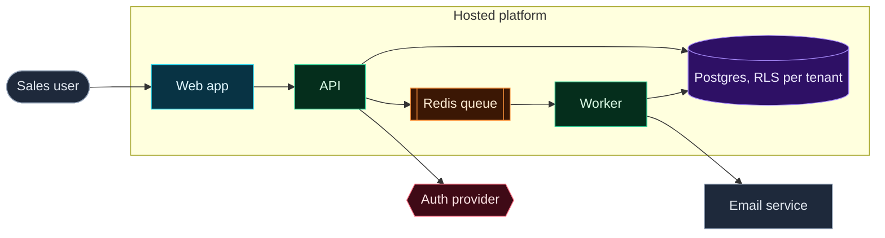
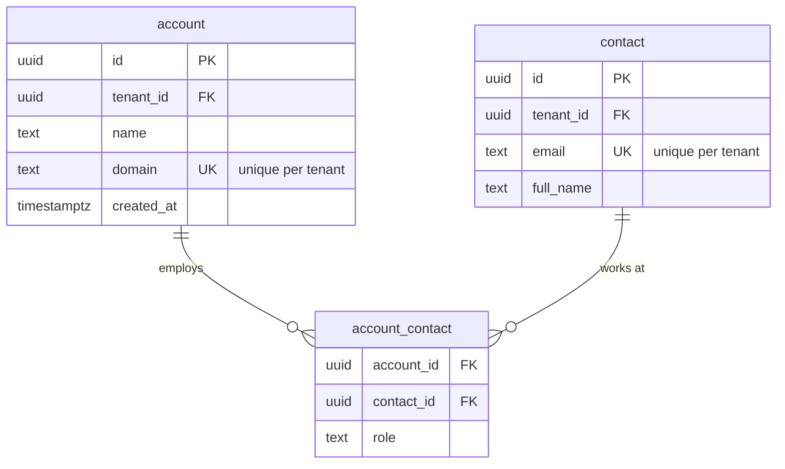

# Diagram conventions

Diagrams are Mermaid blocks inside the plan docs, so they live in git, show in a diff and render on GitHub and in IDEs. The look and the vocabulary follow archify (github.com/tt-a1i/archify, Apache-2.0): every node has a semantic type with a fixed color, boundaries are drawn as groups, and one diagram shows 8 to 12 core nodes. archify itself is not installed; it needs Node, Chrome and an update check, and it writes HTML outside git.

Every diagram sits under its own heading that carries a reserved `D-xx` ID (the Lead reserves them with `plan_state.py alloc D`) and a `Covers:` line with the F IDs it shows, for example `#### D-03 ERD: sales` and `Covers: F-01, F-04`. The Lead's review page (`preview.py`) links each D to its features.

## Semantic types
Paste this block at the end of every `flowchart` and use only these classes.

```
classDef frontend fill:#083344,stroke:#22D3EE,color:#E0F7FF
classDef backend fill:#052E1C,stroke:#34D399,color:#DCFCE7
classDef database fill:#2E1065,stroke:#A78BFA,color:#EDE9FE
classDef cloud fill:#3B2A05,stroke:#FBBF24,color:#FEF3C7
classDef security fill:#3F0A16,stroke:#FB7185,color:#FFE4E6
classDef messagebus fill:#3B1704,stroke:#FB923C,color:#FFEDD5
classDef external fill:#1E293B,stroke:#94A3B8,color:#E2E8F0
```

| Type | Use for |
|---|---|
| frontend | web app, mobile app, admin UI |
| backend | API, worker, scheduled job |
| database | Postgres, Redis as a store, object storage |
| cloud | load balancer, CDN, managed platform service |
| security | auth provider, secrets, WAF, boundary checks |
| messagebus | queue, stream, webhook dispatcher |
| external | third-party systems and the user's own other systems |

Boundaries: a `subgraph` for a region, network or trust zone (for example `subgraph vpc [Private network]`). A security group or trust boundary gets a label that says what it protects.

## Which diagram where

| Doc | Diagram | Mermaid |
|---|---|---|
| UX | main journeys, one per P1 story group | `flowchart LR` |
| UX | screen map and navigation | `flowchart TD` |
| DOM | data model of the domain | `erDiagram` |
| DOM | lifecycle of a record with states | `stateDiagram-v2` |
| system ADR | containers and infrastructure (C4 level 2) | `flowchart LR` with subgraphs |
| system ADR | one key flow across containers (import, sign-in, webhook) | `sequenceDiagram` |

## Data model rules (erDiagram)
- Table-first: entity names are table names (`account`, `deal_stage_history`), attributes carry SQL types.
- Types are one word: write `numeric amount "14,2; optional"`, not `numeric(14,2)`; precision and length go into the comment.
- Mark keys: `uuid id PK`, `uuid account_id FK`, `text email UK`. Add a short quoted comment when the rule is not obvious: `text email UK "unique per tenant"`.
- Every tenant table shows `uuid tenant_id FK`.
- Relations use crow's foot and a verb: `account ||--o{ contact : "employs"`.
- One diagram per domain, at most 12 entities; link to other domains by naming the foreign key only.

## Example: infrastructure



## Example: data model



## Keep diagrams honest
- A diagram shows what the doc decides, nothing more. A planned but undecided part is drawn with a dashed edge (`-.->`) and named as an `OPEN` item.
- When the text and a diagram disagree, the text is wrong or the diagram is; fix one before the role returns.
